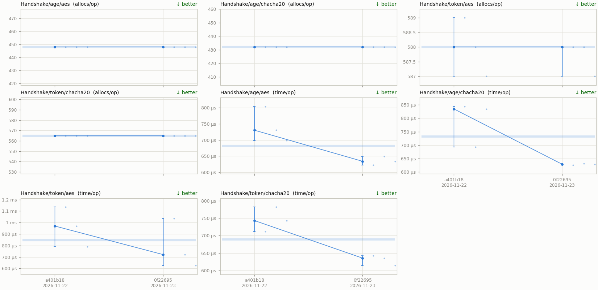
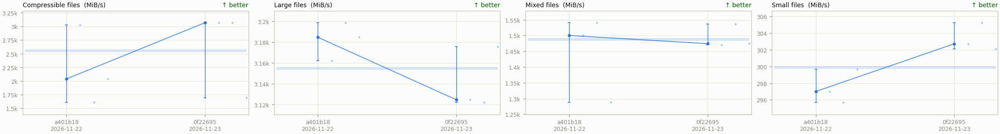
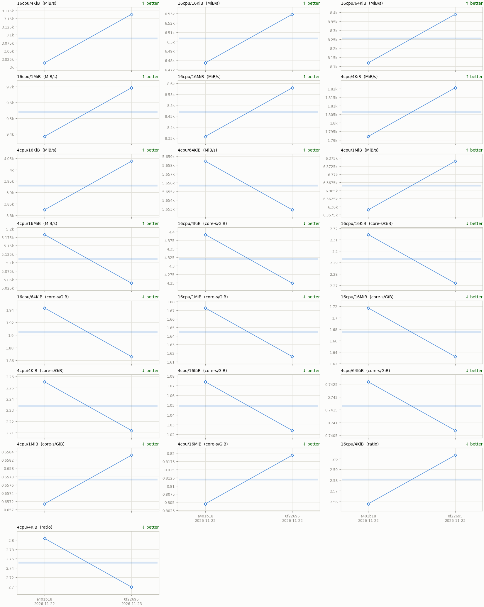

# tx performance history

Latest: [0f22695](https://github.com/jolynch/tx/commit/0f226957a86ff1053d7f0a6d56ef27b0177b30b9) (2026-11-23).

One point per `main` merge: the median, with repeats as dots and min–max whiskers. Red and green lines mark sustained shifts. A dashed line means the benchmark changed; dotted, the machine.

## Shifts

None detected.

## Latest SSD copies

Median and range across measured copies.

| Workload | Throughput (MiB/s) | Copy time | Verification time | Most-used codec by frame count |
| --- | --- | --- | --- | --- |
| Compressible files | 3,064 (1,691–3,065) | 4.01 s (4.01–7.27) | 0.188 s (0.177–0.189) | none (100.0%) |
| Large files | 3,125 (3,122–3,176) | 13.1 s (12.9–13.1) | 6.88 s (6.86–6.93) | none (100.0%) |
| Mixed files | 1,474 (1,470–1,537) | 22.2 s (21.3–22.3) | 6.07 s (6.02–6.27) | none (100.0%) |
| Small files | 303 (302–305) | 6.77 s (6.71–6.78) | 0.55 s (0.541–0.567) | none (100.0%) |

## Ciphers and codecs

## Control path

## Handshake

## Sender frames

## SSD copies

## SSD copy and verification times

## Transfer, AES-GCM

## Transfer, ChaCha20-Poly1305

## Transfer, plaintext

## Verification

## Reproduce the workloads

Print the commands from the measured checkout.

~~~bash
git checkout 0f226957a86ff1053d7f0a6d56ef27b0177b30b9
make bench-suite-commands BENCH_SUITE=full
~~~

How shifts are detected

Flagged when the 8 measured commits before and after don't overlap and their medians differ by at least 5% and 4× the median absolute deviation. Needs three commits after; never spans a dashed or dotted line.

