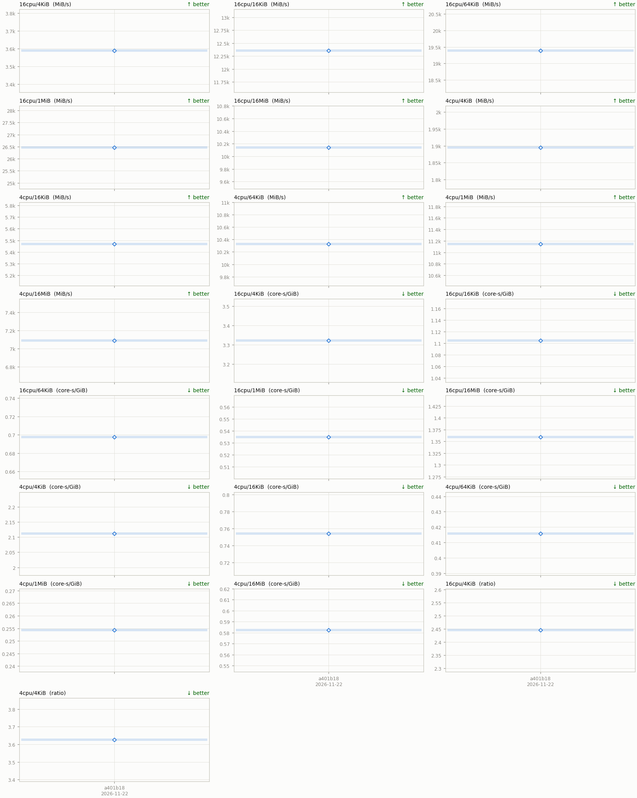
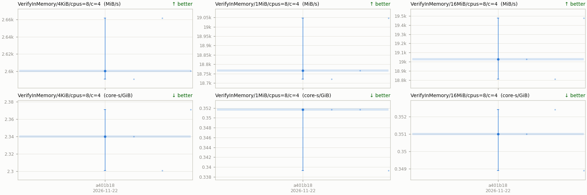

# tx performance history

Latest: [a401b18](https://github.com/jolynch/tx/commit/a401b18e6c8ec5325de0a0737bde9586bca1fa05) (2026-11-22).

One point per `main` merge: the median, with repeats as dots and min–max whiskers. Red and green lines mark sustained shifts. A dashed line means the benchmark changed; dotted, the machine.

## Shifts

None detected.

## Latest SSD copies

Median and range across measured copies.

| Workload | Throughput (MiB/s) | Copy time | Verification time | Most-used codec by frame count |
| --- | --- | --- | --- | --- |
| Compressible files | 2,037 (1,608–3,024) | 6.03 s (4.06–7.64) | 0.186 s (0.182–0.189) | none (100.0%) |
| Large files | 3,185 (3,162–3,199) | 12.9 s (12.8–13) | 6.61 s (6.45–6.66) | none (100.0%) |
| Mixed files | 1,500 (1,288–1,541) | 21.8 s (21.3–25.4) | 4.72 s (4.71–5.07) | none (100.0%) |
| Small files | 297 (296–300) | 6.9 s (6.83–6.93) | 0.59 s (0.589–0.594) | none (100.0%) |

## Ciphers and codecs

## Control path

## Handshake

## Sender frames

## SSD copies

## SSD copy and verification times

## Transfer, AES-GCM

## Transfer, ChaCha20-Poly1305

## Transfer, plaintext

## Verification

## Reproduce the workloads

Print the commands from the measured checkout.

~~~bash
git checkout a401b18e6c8ec5325de0a0737bde9586bca1fa05
make bench-suite-commands BENCH_SUITE=full
~~~

How shifts are detected

Flagged when the 8 measured commits before and after don't overlap and their medians differ by at least 5% and 4× the median absolute deviation. Needs three commits after; never spans a dashed or dotted line.

