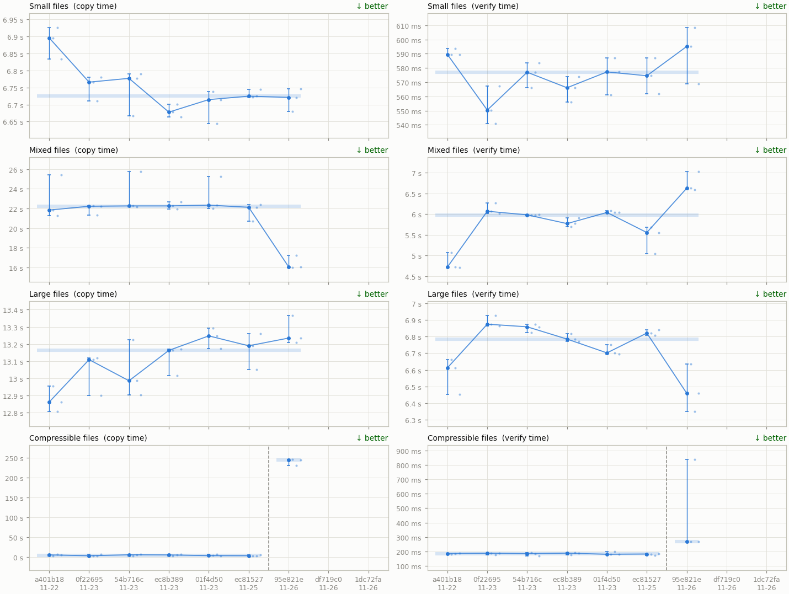

# tx performance history

Latest: [95e821e](https://github.com/jolynch/tx/commit/95e821e5aca7fa7a2052348622937c30173283fb) (2026-11-26).

One point per `main` merge: the median, with repeats as dots and min–max whiskers. Red and green lines mark sustained shifts. A dashed line means the benchmark changed; dotted, the machine.

## Shifts

None detected.

## End-to-End Copy Suites

Median and range across measured copies.

| Workload | Throughput (MiB/s) | Copy time | Verification time | Most-used codec by frame count |
| --- | --- | --- | --- | --- |
| Compressible files | 50.2 (50.1–53.4) | 245 s (230–245) | 0.27 s (0.267–0.837) | none (96.3%) |
| Large files | 3,095 (3,065–3,101) | 13.2 s (13.2–13.4) | 6.46 s (6.35–6.64) | none (100.0%) |
| Mixed files | 2,037 (1,899–2,049) | 16.1 s (16–17.3) | 6.62 s (6.59–7.03) | none (100.0%) |
| Small files | 305 (304–307) | 6.72 s (6.68–6.75) | 0.595 s (0.569–0.608) | none (100.0%) |

## End-to-End Copy Suites, throughput

Commands

~~~bash
git checkout 95e821e5aca7fa7a2052348622937c30173283fb
GOFLAGS= GOWORK=off go build -o ./tx ./cmd/tx
GOFLAGS= GOWORK=off go build -o ./tx-bench ./cmd/tx-bench
DATA=/path/on/the/drive/under/test  # remove the -dst trees between runs

# ssd-compressible: Compressible files
./tx-bench prep --size 12GiB --mix silesia=100%@128MiB..1GiB --seed 1 --check "$DATA/ssd-compressible-src"
./tx-bench local --tx ./tx --auth off --cache-warm 0% --require-cold-cache 10% --expect 97fe88a9a8b1a364 --oracle full -w 0 -n 3 --send-arg=--bwlimit --send-arg=50MiB "$DATA/ssd-compressible-src" "$DATA/ssd-compressible-dst"

# ssd-large: Large files
./tx-bench prep --size 40GiB --mix rand=100%@2GiB --seed 1 --check "$DATA/ssd-large-src"
./tx-bench local --tx ./tx --auth off --cache-warm 0% --require-cold-cache 10% --expect 1a2eca0ea833af19 --oracle full -w 0 -n 3 "$DATA/ssd-large-src" "$DATA/ssd-large-dst"

# ssd-mixed: Mixed files
./tx-bench prep --size 32GiB --mix rand=25%@4KiB..256KiB,rand=25%@1GiB,silesia=50%@128MiB..1GiB --seed 1 --check "$DATA/ssd-mixed-src"
./tx-bench local --tx ./tx --auth off --cache-warm 0% --require-cold-cache 10% --expect 641292361748a31d --oracle full -w 0 -n 3 "$DATA/ssd-mixed-src" "$DATA/ssd-mixed-dst"

# ssd-small: Small files
./tx-bench prep --size 2GiB --mix rand=100%@16KiB --seed 1 --check "$DATA/ssd-small-src"
./tx-bench local --tx ./tx --auth off --cache-warm 0% --require-cold-cache 10% --expect 44c4cc0c5b8e9dc2 --oracle full -w 0 -n 3 "$DATA/ssd-small-src" "$DATA/ssd-small-dst"
~~~

## End-to-End Copy Suites, copy and verification times

Same commands as [End-to-End Copy Suites, throughput](#end-to-end-copy-suites-throughput).

## Transfer

Commands

~~~bash
git checkout 95e821e5aca7fa7a2052348622937c30173283fb

# transfer
TX_BENCH_THROUGHPUT_MIN_WALL=5s make bench-throughput THROUGHPUT_SIZE=256MiB THROUGHPUT_CPUS=4,16 THROUGHPUT_ENCRYPT=none,aes,chacha20
~~~

## Ciphers and codecs

Commands

~~~bash
git checkout 95e821e5aca7fa7a2052348622937c30173283fb

# cipher
go test '-run=^$' -cpu=8 -benchmem -benchtime=1s -count=3 '-bench=^Benchmark(Encrypt|Decrypt)Throughput$/^1MiB$/^(aesgcm|chacha20poly1305)$' ./internal/aead

# codec
go test '-run=^$' -cpu=8 -benchmem -benchtime=1s -count=3 '-bench=^BenchmarkWrapDecompressedReader$/^(zstd|lz4)$' ./internal/bench
~~~

## Control path

Commands

~~~bash
git checkout 95e821e5aca7fa7a2052348622937c30173283fb

# ack
go test '-run=^$' -cpu=8 -benchmem -benchtime=1s -count=3 '-bench=^BenchmarkServePlaintextACKBody$' ./internal/filexfer/ftcp

# ack-store
go test '-run=^$' -cpu=8 -benchmem -benchtime=1s -count=3 '-bench=^BenchmarkTransferStoreAckBatch$' ./internal/bench

# request
go test '-run=^$' -cpu=8 -benchmem -benchtime=1s -count=3 '-bench=^BenchmarkRequestRecords$/^(short-paths|long-paths)$' ./internal/filexfer/ftcp

# split
go test '-run=^$' -cpu=8 -benchmem -benchtime=1s -count=3 '-bench=^BenchmarkSplitEncodedRequests$/^(short-paths|long-paths)$' .
~~~

## Handshake

Commands

~~~bash
git checkout 95e821e5aca7fa7a2052348622937c30173283fb

# handshake
go test '-run=^$' -cpu=8 -benchmem -benchtime=1s -count=3 '-bench=^BenchmarkHandshake$/^(token|age)$/^(aes|chacha20)$' ./internal/aead
~~~

## Sender frames

Commands

~~~bash
git checkout 95e821e5aca7fa7a2052348622937c30173283fb

# frames
go test '-run=^$' -cpu=8 -benchmem -benchtime=1s -count=3 '-bench=^BenchmarkSendFramePayload$/^(zerocopy|buffered)$/^(4KiB|1MiB)$' ./internal/filexfer/ftcp
~~~

## Verification

Commands

~~~bash
git checkout 95e821e5aca7fa7a2052348622937c30173283fb

# verify
TX_VERIFY_BYTES=268435456 TX_VERIFY_CONCURRENCY=4 TX_VERIFY_IO_DEPTH=4 TX_VERIFY_IO_LATENCY='' go test '-run=^$' -cpu=8 -benchmem -benchtime=1s -count=3 '-bench=^BenchmarkVerifyInMemory$/^(4KiB|1MiB|16MiB)$/^cpus=8$/^c=4$' ./internal/cmd/filexfercli
~~~

## Reproduce the workloads

Print the commands from the measured checkout.

~~~bash
git checkout 95e821e5aca7fa7a2052348622937c30173283fb
make bench-suite-commands BENCH_SUITE=full
~~~

How shifts are detected

Flagged when the 8 measured commits before and after don't overlap and their medians differ by at least 5% and 4× the median absolute deviation. Needs three commits after; never spans a dashed or dotted line.

Not measured: 1dc72fa, df719c0.

