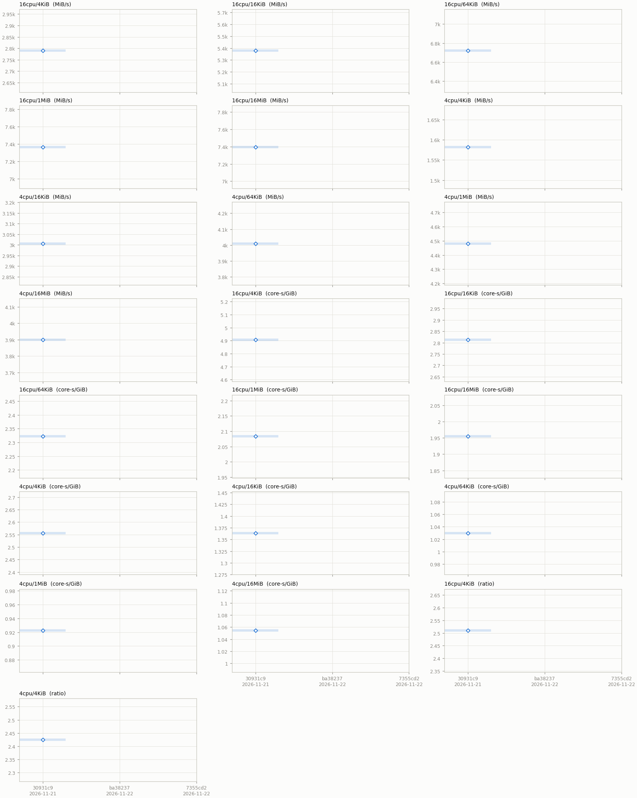
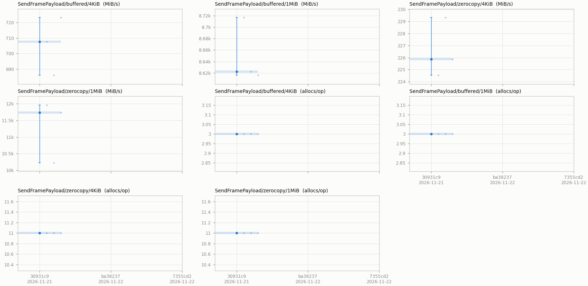

# tx performance history

Latest: [30931c9](https://github.com/jolynch/tx/commit/30931c9a3520d761be81f3ffadeaab7d951bbec6) (2026-11-21).

One point per `main` merge: the median, with repeats as dots and min–max whiskers. Red and green lines mark sustained shifts. A dashed line means the benchmark changed; dotted, the machine.

## Shifts

None detected.

## SSD copies

Commands

~~~bash
git checkout 30931c9a3520d761be81f3ffadeaab7d951bbec6 && make build
DATA=/path/on/the/drive/under/test

# ssd-large
./tx-bench prep --size 128GiB --mix rand=100%@2GiB --seed 1 --check "$DATA/ssd-large-src"
./tx-bench local --tx ./tx --auth off --cache-warm 0% --expect 769d4550fd9ac281 --oracle full -w 0 -n 1 "$DATA/ssd-large-src" "$DATA/ssd-large-dst" -- --compress none --encrypt none
# ssd-small
./tx-bench prep --size 2GiB --mix rand=100%@16KiB --seed 1 --check "$DATA/ssd-small-src"
./tx-bench local --tx ./tx --auth off --cache-warm 0% --expect 44c4cc0c5b8e9dc2 --oracle full -w 0 -n 1 "$DATA/ssd-small-src" "$DATA/ssd-small-dst" -- --compress none --encrypt none
# ssd-varied
./tx-bench prep --size 128GiB --mix rand=100%@128MiB..1324MiB --seed 1 --check "$DATA/ssd-varied-src"
./tx-bench local --tx ./tx --auth off --cache-warm 0% --expect cdde786b5ca1e0f5 --oracle full -w 0 -n 1 "$DATA/ssd-varied-src" "$DATA/ssd-varied-dst" -- --compress none --encrypt none
~~~

## Transfer, plaintext

Commands

~~~bash
git checkout 30931c9a3520d761be81f3ffadeaab7d951bbec6

# transfer
TX_BENCH_THROUGHPUT_CPUS=4,16 TX_BENCH_THROUGHPUT_ENCRYPT=none,aes,chacha20 TX_BENCH_THROUGHPUT_MIN_WALL=5s TX_BENCH_THROUGHPUT_SIZE=256MiB go test -count=1 -timeout 10m -run '^TestTransferCostRatio$' -v ./internal/bench
~~~

## Transfer, AES-GCM

Same command as [Transfer, plaintext](#transfer-plaintext).

## Transfer, ChaCha20-Poly1305

Same command as [Transfer, plaintext](#transfer-plaintext).

## Verification

Commands

~~~bash
git checkout 30931c9a3520d761be81f3ffadeaab7d951bbec6

# verify
TX_VERIFY_BYTES=268435456 TX_VERIFY_CONCURRENCY=4 TX_VERIFY_IO_DEPTH=4 TX_VERIFY_IO_LATENCY= go test '-run=^$' -cpu=8 -benchmem -benchtime=1s -count=3 '-bench=^BenchmarkVerifyInMemory$/^(4KiB|1MiB|16MiB)$/^cpus=8$/^c=4$' ./internal/cmd/filexfercli
~~~

## Sender frames

Commands

~~~bash
git checkout 30931c9a3520d761be81f3ffadeaab7d951bbec6

# frames
go test '-run=^$' -cpu=8 -benchmem -benchtime=1s -count=3 '-bench=^BenchmarkSendFramePayload$/^(zerocopy|buffered)$/^(4KiB|1MiB)$' ./internal/filexfer/ftcp
~~~

## Ciphers and codecs

Commands

~~~bash
git checkout 30931c9a3520d761be81f3ffadeaab7d951bbec6

# cipher
go test '-run=^$' -cpu=8 -benchmem -benchtime=1s -count=3 '-bench=^Benchmark(Encrypt|Decrypt)Throughput$/^1MiB$/^(aesgcm|chacha20poly1305)$' ./internal/aead
# codec
go test '-run=^$' -cpu=8 -benchmem -benchtime=1s -count=3 '-bench=^BenchmarkWrapDecompressedReader$/^(zstd|lz4)$' ./internal/bench
~~~

## Handshake

Commands

~~~bash
git checkout 30931c9a3520d761be81f3ffadeaab7d951bbec6

# handshake
go test '-run=^$' -cpu=8 -benchmem -benchtime=1s -count=3 '-bench=^BenchmarkHandshake$/^(token|age)$/^(aes|chacha20)$' ./internal/aead
~~~

## Control path

Commands

~~~bash
git checkout 30931c9a3520d761be81f3ffadeaab7d951bbec6

# ack
go test '-run=^$' -cpu=8 -benchmem -benchtime=1s -count=3 '-bench=^BenchmarkServePlaintextACKBody$' ./internal/filexfer/ftcp
# ack-store
go test '-run=^$' -cpu=8 -benchmem -benchtime=1s -count=3 '-bench=^BenchmarkTransferStoreAckBatch$' ./internal/bench
# request
go test '-run=^$' -cpu=8 -benchmem -benchtime=1s -count=3 '-bench=^BenchmarkRequestRecords$/^(short-paths|long-paths)$' ./internal/filexfer/ftcp
# split
go test '-run=^$' -cpu=8 -benchmem -benchtime=1s -count=3 '-bench=^BenchmarkSplitEncodedRequests$/^(short-paths|long-paths)$' .
~~~

How shifts are detected

Flagged when the 8 measured commits before and after don't overlap and their medians differ by at least 5% and 4× the median absolute deviation. Needs three commits after; never spans a dashed or dotted line.

Not measured: 7355cd2, ba38237.

