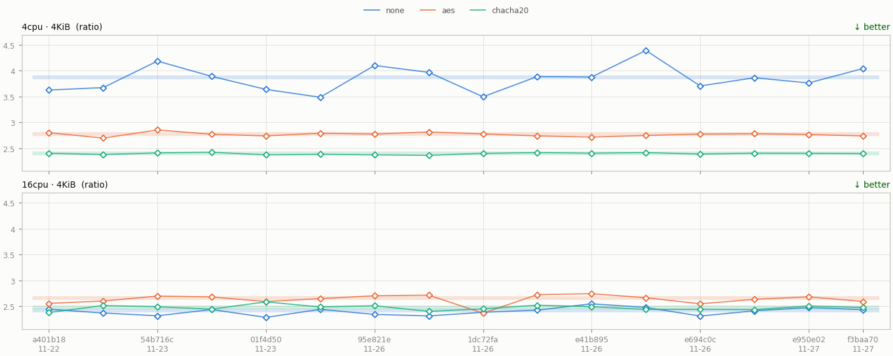
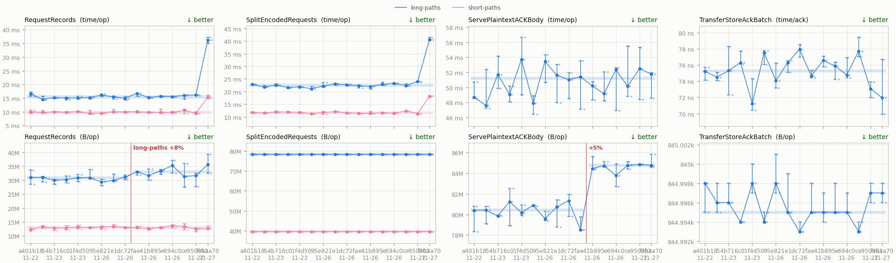
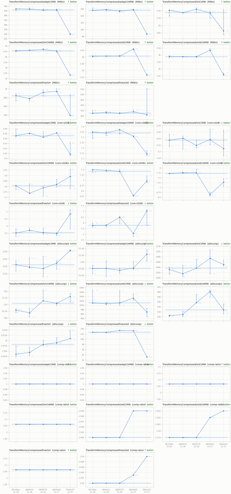

# tx performance history

Latest: [f3baa70](https://github.com/jolynch/tx/commit/f3baa709d02e5dd64216f71138fd674a87df2375) (2026-11-27).

One point per `main` merge: the median, with repeats as dots and min–max whiskers. Red and green lines mark sustained shifts. A dotted line means the machine changed. A changed benchmark starts a new series, so only its current definition is plotted.

## Shifts

| Commits | Worse | Better |
|---|---|---|
| [aeb3456…e41b895](https://github.com/jolynch/tx/compare/aeb3456be5c1c8744cfee8437b6a7e18c0650d73...e41b89511b79e11f6e37f787f1bd0a2a8983b4c5) | +5% [ServePlaintextACKBody](#control-path) B/op |  |
| [1dc72fa…aeb3456](https://github.com/jolynch/tx/compare/1dc72fa086e85cdfe39c6359bd1ce4463800e7db...aeb3456be5c1c8744cfee8437b6a7e18c0650d73) | +8% [RequestRecords/long-paths](#control-path) B/op | +297% [WrapDecompressedReader/lz4](#ciphers-and-codecs) MiB/s -33% [WrapDecompressedReader/lz4](#ciphers-and-codecs) allocs/op |

## End-to-End Copy Suites

Median and range across measured copies.

| Workload | Throughput (MiB/s) | Copy time | Verification time | Most-used codec by frame count |
| --- | --- | --- | --- | --- |
| Compressible files | 73 (60.6–73.3) | 168 s (168–203) | 0.182 s (0.182–0.285) | none (58.5%) |
| Large files | 3,041 (3,004–3,057) | 13.5 s (13.4–13.6) | 6.42 s (6.39–6.47) | none (100.0%) |
| Mixed files | 1,602 (1,526–1,611) | 20.5 s (20.3–21.5) | 5.96 s (5.94–5.99) | none (100.0%) |
| Small files | 287 (283–298) | 7.15 s (6.86–7.23) | 0.642 s (0.637–0.669) | none (100.0%) |

## End-to-End Copy Suites, throughput

Commands

~~~bash
git checkout f3baa709d02e5dd64216f71138fd674a87df2375
GOFLAGS= GOWORK=off go build -o ./tx ./cmd/tx
GOFLAGS= GOWORK=off go build -o ./tx-bench ./cmd/tx-bench
DATA=/path/on/the/drive/under/test  # remove the -dst trees between runs

# ssd-compressible: Compressible files
./tx-bench prep --size 12GiB --mix silesia=100%@128MiB..1GiB --seed 1 --check "$DATA/ssd-compressible-src"
./tx-bench local --tx ./tx --auth off --cache-warm 0% --require-cold-cache 10% --expect 97fe88a9a8b1a364 --oracle full -w 0 -n 3 --send-arg=--bwlimit --send-arg=50MiB "$DATA/ssd-compressible-src" "$DATA/ssd-compressible-dst"

# ssd-large: Large files
./tx-bench prep --size 40GiB --mix rand=100%@2GiB --seed 1 --check "$DATA/ssd-large-src"
./tx-bench local --tx ./tx --auth off --cache-warm 0% --require-cold-cache 10% --expect 1a2eca0ea833af19 --oracle full -w 0 -n 3 "$DATA/ssd-large-src" "$DATA/ssd-large-dst"

# ssd-mixed: Mixed files
./tx-bench prep --size 32GiB --mix rand=25%@4KiB..256KiB,rand=25%@1GiB,silesia=50%@128MiB..1GiB --seed 1 --check "$DATA/ssd-mixed-src"
./tx-bench local --tx ./tx --auth off --cache-warm 0% --require-cold-cache 10% --expect 641292361748a31d --oracle full -w 0 -n 3 "$DATA/ssd-mixed-src" "$DATA/ssd-mixed-dst"

# ssd-small: Small files
./tx-bench prep --size 2GiB --mix rand=100%@16KiB --seed 1 --check "$DATA/ssd-small-src"
./tx-bench local --tx ./tx --auth off --cache-warm 0% --require-cold-cache 10% --expect 44c4cc0c5b8e9dc2 --oracle full -w 0 -n 3 "$DATA/ssd-small-src" "$DATA/ssd-small-dst"
~~~

## End-to-End Copy Suites, copy and verification times

Same commands as [End-to-End Copy Suites, throughput](#end-to-end-copy-suites-throughput).

## Transfer

Commands

~~~bash
git checkout f3baa709d02e5dd64216f71138fd674a87df2375

# transfer
TX_BENCH_THROUGHPUT_MIN_WALL=5s make bench-throughput THROUGHPUT_SIZE=256MiB THROUGHPUT_CPUS=4,16 THROUGHPUT_ENCRYPT=none,aes,chacha20
~~~

## Ciphers and codecs

Commands

~~~bash
git checkout f3baa709d02e5dd64216f71138fd674a87df2375

# cipher
go test '-run=^$' -cpu=8 -benchmem -benchtime=1s -count=3 '-bench=^Benchmark(Encrypt|Decrypt)Throughput$/^1MiB$/^(aesgcm|chacha20poly1305)$' ./internal/aead

# codec
go test '-run=^$' -cpu=8 -benchmem -benchtime=1s -count=3 '-bench=^BenchmarkWrapDecompressedReader$/^(zstd|lz4)$' ./internal/bench

# frame-codec
go test '-run=^$' -cpu=8 -benchmem -benchtime=1s -count=3 '-bench=^BenchmarkAppendCompressedFrame$/^(lz4|zstd)$/^(c1|auto)$' ./internal/bench
~~~

## Control path

Commands

~~~bash
git checkout f3baa709d02e5dd64216f71138fd674a87df2375

# ack
go test '-run=^$' -cpu=8 -benchmem -benchtime=1s -count=3 '-bench=^BenchmarkServePlaintextACKBody$' ./internal/filexfer/ftcp

# ack-store
go test '-run=^$' -cpu=8 -benchmem -benchtime=1s -count=3 '-bench=^BenchmarkTransferStoreAckBatch$' ./internal/bench

# request
go test '-run=^$' -cpu=8 -benchmem -benchtime=1s -count=3 '-bench=^BenchmarkRequestRecords$/^(short-paths|long-paths)$' ./internal/filexfer/ftcp

# split
go test '-run=^$' -cpu=8 -benchmem -benchtime=1s -count=3 '-bench=^BenchmarkSplitEncodedRequests$/^(short-paths|long-paths)$' .
~~~

## Handshake

Commands

~~~bash
git checkout f3baa709d02e5dd64216f71138fd674a87df2375

# handshake
go test '-run=^$' -cpu=8 -benchmem -benchtime=1s -count=3 '-bench=^BenchmarkHandshake$/^(token|age)$/^(aes|chacha20)$' ./internal/aead
~~~

## Sender frames

Commands

~~~bash
git checkout f3baa709d02e5dd64216f71138fd674a87df2375

# frames
go test '-run=^$' -cpu=8 -benchmem -benchtime=1s -count=3 '-bench=^BenchmarkSendFramePayload$/^(zerocopy|buffered)$/^(4KiB|1MiB)$' ./internal/filexfer/ftcp
~~~

## Compressed transfer

Commands for transfer-compressed were not recorded; see [Reproduce the workloads](#reproduce-the-workloads).

## Verification

Commands

~~~bash
git checkout f3baa709d02e5dd64216f71138fd674a87df2375

# verify
TX_VERIFY_BYTES=268435456 TX_VERIFY_CONCURRENCY=4 TX_VERIFY_IO_DEPTH=4 TX_VERIFY_IO_LATENCY='' go test '-run=^$' -cpu=8 -benchmem -benchtime=1s -count=3 '-bench=^BenchmarkVerifyInMemory$/^(4KiB|1MiB|16MiB)$/^cpus=8$/^c=4$' ./internal/cmd/filexfercli
~~~

## Reproduce the workloads

Print the commands from the measured checkout.

~~~bash
git checkout f3baa709d02e5dd64216f71138fd674a87df2375
make bench-suite-commands BENCH_SUITE=full
~~~

How shifts are detected

Flagged when the 8 measured commits before and after don't overlap and their medians differ by at least 5% and 4× the median absolute deviation. Needs three commits after; never spans a dotted line.

