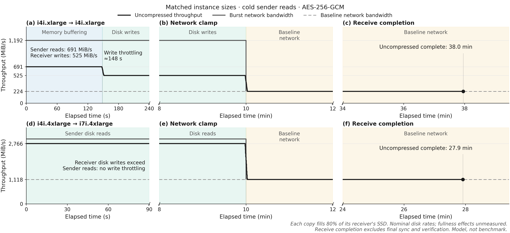
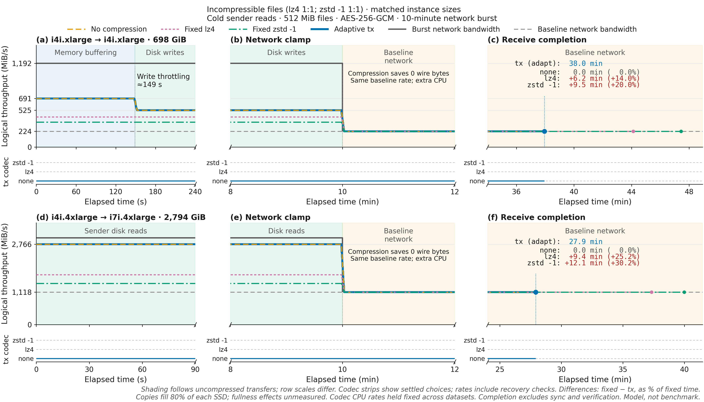
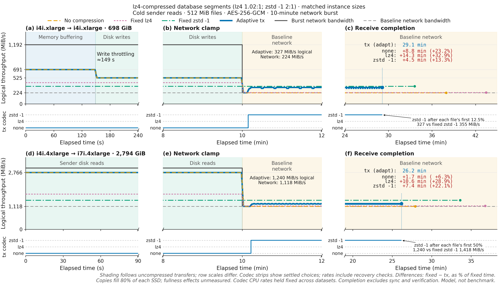
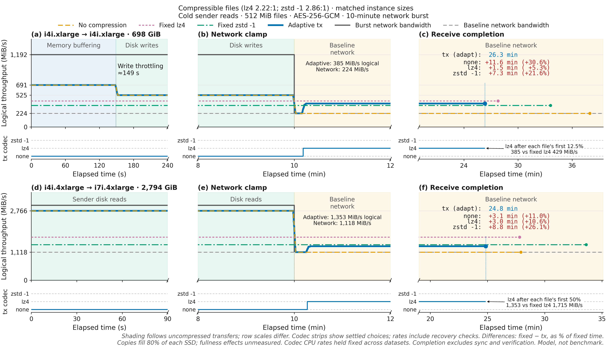
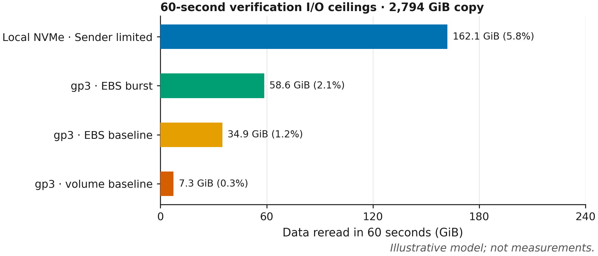
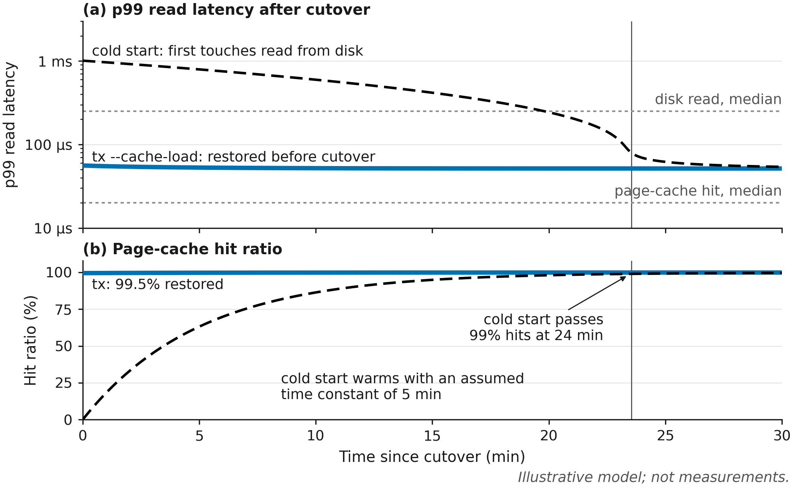

# Cloud transfer limits

A cloud copy's bottleneck moves while it runs: the sender's disk, the
receiver's disk, then the network once burst credits run out. Whether
compression helps depends on the data and on which limit applies at the
moment, so tx **adapts** to both.

The model covers two copies between hosts of the same size:
**i4i.xlarge → i4i.xlarge** and **i4i.4xlarge → i7i.4xlarge**. Each starts
with an empty receiver and fills 80% of its SSD, **698 GiB** and
**2,794 GiB** before filesystem overhead, in **512 MiB files**. The rate
plots compare bottlenecks, not equal copy sizes. All hosts use local NVMe and
multiple TCP connections over a private same-VPC route.

## Hardware

| Capability             | i4i.xlarge sender/receiver | i4i.4xlarge sender |     i7i.4xlarge receiver |
| ---------------------- | -------------------------: | -----------------: | -----------------------: |
| CPU                    |          4 vCPUs, Ice Lake | 16 vCPUs, Ice Lake | 16 vCPUs, Emerald Rapids |
| Memory                 |                     32 GiB |            128 GiB |                  128 GiB |
| Local SSD              |                    873 GiB |          3,492 GiB |                3,492 GiB |
| Baseline network       |                 1.875 Gbps |         9.375 Gbps |               9.375 Gbps |
| Burst network          |                    10 Gbps |            25 Gbps |                  25 Gbps |
| Sequential disk reads  |                 ≈691 MiB/s |        2,766 MiB/s |             ≈4,096 MiB/s |
| Sequential disk writes |                 ≈525 MiB/s |        2,098 MiB/s |             ≈3,174 MiB/s |

[AWS][so] supplies the host specifications. Netflix's
[i4i][scm-i4i] and [i7i][scm-i7i] catalogs agree on network baseline and
storage capacity, but contain random IOPS, not sequential bandwidth.
The disk rates above come from [CloudSort's fio measurements][cloudsort]
and [RunsOn's fio results][runson]. The i4i.xlarge disk rates are projections,
scaled linearly from i4i.4xlarge; its write projection is 525 MiB/s.

[AWS's i4i launch specifications][i4i-reads] also list about 2,670 MiB/s of
sequential reads on 4xlarge. The model uses CloudSort's nominal cold-read
rate, not a universal SSD maximum. Cached sender data can behave differently.

RunsOn uses a 2 GiB file and a 20-second measurement. It does not establish
sustained write speed as the receiver fills to 80%. [AWS warns][ssd] that
SSD write performance falls with occupancy, but provides no numeric
penalty. The model holds disk rates constant; the fullness effect remains
unmeasured.

## Where the limit moves

The xlarge receiver passes through three phases:

1. **Memory buffering during network burst:** sender disk reads supply 691 MiB/s; page cache absorbs writes above disk speed.
2. **Receiver disk writes:** 525 MiB/s. Dirty memory fills after about 150 seconds.
3. **Baseline network:** 224 MiB/s. Network credits run out.

On xlarge, **sender disk reads** supply 691 MiB/s during the network burst,
below the 1,192 MiB/s network limit but above the receiver's 525 MiB/s disk
write rate. RAM absorbs the roughly 166 MiB/s difference until dirty
memory approaches the write-throttling limit.

On 4xlarge, **sender disk reads** supply 2,766 MiB/s, below the receiver's
3,174 MiB/s write rate. The receiver still uses page cache, but dirty data
doesn't accumulate toward the write-throttling limit. When network credits
run out, **baseline networking** limits the copy to 1,118 MiB/s.

The model allows up to 80% dirty memory, with background writeback starting
at 5%, following [Netflix's tuning][netflix]. That allows up to 25.6 GiB of
dirty memory on xlarge and 102.4 GiB on 4xlarge. Linux applies the
percentages to [available memory][vm], so actual thresholds can be lower.

## Compression depends on the data

The three scenarios use the same hardware, file sizes, and codec CPU rates.
Ratios describe additional compression of the bytes already on disk:

| Files                       |    lz4 | zstd -1 | tx after network clamp |
| --------------------------- | -----: | ------: | ---------------------- |
| Incompressible              |    1:1 |     1:1 | **none**               |
| Already compressed with lz4 | 1.02:1 |     2:1 | **zstd -1**            |
| Compressible, uncompressed  | 2.22:1 |  2.86:1 | **lz4**                |

### Incompressible: stay at none

Compression saves no network bytes. During the network burst, fixed lz4 and
zstd -1 spend CPU and fall below the sender's disk-read rate. After the
network clamp, they can fill baseline network bandwidth but cannot recover
the time lost early. tx stays uncompressed.

### Already lz4-compressed: choose zstd -1

Database segment files are often compressed page by page. Another lz4 pass
gains almost nothing; the model assumes zstd -1 still finds redundancy
across pages. tx sends uncompressed during the network burst, then selects
zstd -1 on both host pairs after the network clamp.

Fixed zstd -1 sustains **355 MiB/s** over the xlarge's **224 MiB/s network**,
and **1,418 MiB/s** over the 4xlarge's **1,118 MiB/s network**. tx pays for
each file's initial uncompressed frames and occasional recovery checks,
averaging **327 MiB/s** and **1,240 MiB/s** after the clamp. Its faster burst
phase still puts it **4.5 minutes ahead of the fastest fixed strategy on
xlarge (13.3%)** and **1.7 minutes ahead on 4xlarge (6.3%)**.

### Compressible: choose lz4

For uncompressed files with Silesia-like ratios, lz4 removes enough network
traffic to make its lower CPU cost decisive. Zstd -1 produces fewer bytes,
but its extra compression work lowers throughput. tx selects lz4 on both
pairs after the network clamp.

Fixed lz4 sustains **429 MiB/s** on xlarge and **1,715 MiB/s** on 4xlarge
after the clamp, above fixed zstd -1's 355 and 1,418 MiB/s. A better ratio
alone does not make a codec faster.

### Reading the figures

Shading follows the uncompressed copy's memory, disk, and network phases.
Dark gray lines show burst network bandwidth dropping to the dashed baseline
network reference. The codec strips show the settled codec; throughput traces
include brief recovery checks. [Background samples][policy] compare upward
candidates without sending trial frames. Compressed streams also check cheaper codecs on real frames,
so measured throughput can overturn an incorrect prediction. Failed checks
use about 1% of steady-state transfer time; detected changes can check sooner.

The modeled codec changes about 9–17 seconds after the network clamp.
This is an illustrative response, not a measured tx latency. In tx, slower
frame writes reopen sampling and clear the unprofitable-sample backoff;
the policy then rebuilds its baseline and compares codecs. Socket buffering,
worker contention, and concurrent windows can delay that response.

Every file starts uncompressed and needs its own compression evidence.
Concurrent windows shorten each chain of learning: the model sends the first
12.5% of each file uncompressed on xlarge and 50% on 4xlarge. Larger files
spend a smaller share warming up. These initial frames explain why adaptive
throughput after the clamp is below its chosen fixed codec's rate.

The right panels mark receive completion, excluding final sync and
verification. Differences are fixed-strategy time minus tx time; `+` marks
extra time for the fixed strategy. Nonzero differences are red; ties are
gray. Each percentage uses that fixed strategy's receive time.

[AWS network bursts are best effort][net]. Past traffic, remaining network
credits, and shared network capacity determine how much is available.
The plots use a 10-minute burst. The table also shows 30 seconds remaining;
neither duration is guaranteed. On xlarge, a 30-second burst ends before
dirty memory fills, skipping the receiver-disk phase.

## Receive time on the 4xlarge pair

The tx rows are model estimates; the rsync rows are optimistic lower bounds.
All copy the lz4-compressed segment files and exclude final sync and
verification. AES-GCM
means **AES-256-GCM**. Percentages compare receive time with the best
modeled codec switch in the same column, which switches the whole copy at
once. The tx row pays each file's warm-up: 50% of every 512 MiB file goes
uncompressed. After a 30-second burst, fixed zstd -1 finishes first: nearly
every file starts after the clamp, and zstd -1 compresses each one from its
first byte.

| Method                                   | 10 min network burst       | 30 s network burst         |
| ---------------------------------------- | -------------------------: | -------------------------: |
| Best modeled codec switch, AES-GCM       |           24.1 min (+0.0%) |           33.1 min (+0.0%) |
| **tx adaptive, AES-GCM**                 |       **26.2 min (+8.5%)** |      **37.9 min (+14.2%)** |
| tx no compression, AES-GCM               |          27.9 min (+15.8%) |          41.9 min (+26.5%) |
| tx fixed lz4, AES-GCM                    |          36.8 min (+52.5%) |          41.6 min (+25.5%) |
| tx fixed zstd -1, AES-GCM                |          33.6 min (+39.4%) |           33.6 min (+1.4%) |
| rsync, plaintext, no compression         | ≥80.0 min (≥231.7% slower) | ≥80.0 min (≥141.4% slower) |
| rsync/SSH, AES-GCM, no compression       | ≥91.8 min (≥280.5% slower) | ≥91.8 min (≥176.9% slower) |
| rsync/SSH, AES-GCM, ideal 2× compression |  ≥46.7 min (≥93.8% slower) |  ≥46.7 min (≥41.0% slower) |

Codecs share all 16 vCPUs with reading, hashing, framing, AES-GCM, and
socket work. The model assumes that pipeline sustains 450 MiB/s per vCPU at
80% parallel efficiency. This is an explicit CPU budget, not a measured tx
or cipher throughput.

The rsync rows are **optimistic lower bounds**, not benchmark results.
They assume one TCP connection outside a cluster placement group, without
ENA Express: [AWS caps that flow at 5 Gbps][net], or 596 MiB/s. Each rsync
and SSH process runs on one core, and the slowest one sets the rate. From
measured rates (see [Model](#model)), plain rsync manages 1,020 MiB/s, so
the flow is its limit; over SSH it manages 520 MiB/s, and an SSH process is
the limit. SSH uses `aes256-gcm@openssh.com` with compression off. The 2×
row assumes ideal compression with no CPU cost on either side, which halves
the bytes SSH carries and leaves rsync's own process as the limit. Current
[rsync supports threaded zstd][rsync]; it is not restricted to one
compression core. Multiple rsync sessions or different network placement
change these bounds.

On incompressible data, adaptive tx matches no compression; fixed codecs
finish later. No measured tx-versus-rsync speedup on these hosts is implied
by the table.

## Throughput scales with instance size

Bigger instances get more vCPUs, more NVMe bandwidth, and more network
bandwidth. `tx` spreads a copy across many connections and runs its pipeline on
every core (see [Concurrency](OVERVIEW.md#concurrency)), so it keeps up as the
network grows. A single TCP flow doesn't:

![Two panels over matched i7i pairs from large to 48xlarge, with vCPUs on a log scale and baseline network assumed linear in vCPUs. (a) Sustained throughput: tx follows baseline network bandwidth from 140 to 11,921 MiB/s; plaintext rsync levels off at 596 MiB/s from 4xlarge and rsync over SSH at 520 MiB/s from 2xlarge. (b) Time to fill 80% of the receiver's SSD after a 10-minute burst: tx takes 23 to 48 minutes at every size, limited by the network from 2xlarge up; rsync grows to 16 hours and rsync over SSH to 18.4 hours on 48xlarge](plots/cloud-scaling.png)

On large and xlarge, baseline network bandwidth limits all three. From
2xlarge, one SSH process caps rsync/SSH at 520 MiB/s; from 4xlarge, one TCP
flow caps plain rsync at 596 MiB/s, the 5 Gbps limit outside a cluster
placement group. tx reaches **11,921 MiB/s on i7i.48xlarge**: 20 times plain
rsync and 23 times rsync/SSH. tx's CPU limit (360 MiB/s per vCPU) and the
NVMe rates stay above baseline network bandwidth at every size, so the
network sets its rate. The rsync lines use the same optimistic bounds as the
table above.

Panel (b) shows how long you actually wait: the time to fill 80% of the
receiver's SSD. It runs the same simulation as the copies above, with a
10-minute burst on sizes that have one, then baseline, plus page cache and
disk limits. The data is incompressible, so tx sends it uncompressed.

tx fills every size in **under 50 minutes**: 26 minutes on 4xlarge and 48
minutes for 33,528 GiB on 48xlarge. The drive grows 96 times from large to
48xlarge, but the network grows with it, so the fill time only doubles. From 2xlarge up, the network limits tx for the
whole fill. On large and xlarge, the burst outruns both disks: sender reads
limit the copy first, then receiver writes once page cache fills, then
baseline network bandwidth once the burst ends.

rsync's single flow doesn't grow with the drive. From 4xlarge up, its fill
time grows in proportion to the drive: 16 hours on 48xlarge, or 18.4 hours
over SSH. That's two workdays waiting on one copy.

Both panels assume baseline network bandwidth grows linearly with vCPUs,
which gives 8xlarge 18.75 Gbps, twice 4xlarge. AWS lists 25 Gbps for
8xlarge; the model uses that as its burst. 48xlarge falls a little short of
linear: AWS lists 100 Gbps, not 112.5.

## Verification is another disk pass

A gp3 receiver is disk-bound once dirty memory fills. On i7i.4xlarge, its
[EBS interface][ebs] has a separate 596 MiB/s baseline and 1,192 MiB/s burst.
A volume provisioned at 1,000 MiB/s is therefore capped at 596 MiB/s when
**EBS** credits run out, even though baseline **VPC network** bandwidth is
1,118 MiB/s. Compression cannot remove this disk bottleneck.

A full cold reread of 2,794 GiB takes at least **80 minutes** at 596 MiB/s,
or **381.5 minutes** at [gp3's 125 MiB/s baseline][gp3]. `--verify 60s`
bounds the extra work. Both hosts hash sampled ranges; only checksums
cross the network. Coverage is limited by the slower disk:

| Receiver storage              | Effective disk-read rate | Read in 60s | Dataset covered |
| ----------------------------- | -----------------------: | ----------: | --------------: |
| Local NVMe; sender limited    |              2,766 MiB/s |   162.1 GiB |            5.8% |
| gp3 provisioned; EBS burst    |              1,000 MiB/s |    58.6 GiB |            2.1% |
| gp3 provisioned; EBS baseline |                596 MiB/s |    34.9 GiB |            1.2% |
| gp3 volume baseline           |                125 MiB/s |     7.3 GiB |            0.3% |

These are disk-read ceilings. Seeks, hashing, metadata, and unfinished
writeback reduce coverage; cache hits can increase it. Verification spreads
samples across files and reports actual coverage with `[partial-ok]` when
the budget expires. Running batches get a short grace period. The copy
itself already checks every window's hash. See [budgeted verification][verify].

## The page cache has to travel too

A copy moves file contents, not the sender's page cache. After cutover, the
new node serves its first reads from disk until demand fills its cache:

With an assumed 5-minute warm-up time constant, a cold node passes 99% hits
about 24 minutes after cutover, and until then p99 read latency stays in the
disk range (about 250 µs to 1 ms). With `--cache-load`, tx restores the
sender's resident pages after the copy succeeds and before cutover, so reads
start warm. The model assumes 99.5% of the hot set is restored; pages evicted
or not yet loaded make up the rest. `--cache-load full` restores everything
resident; `--cache-load <duration>` stops at its time budget. The cold curve
starts at 0% hits and ignores data the copy itself left in the receiver's
cache, which helps only if that data is the hot set. Latencies are assumed
lognormal: hits around a 20 µs median, misses around 250 µs.

## Model

The model uses fixed rates; transfer curves show 3-second averages. Codec
speeds come from tx's own frame encoders and decoders, measured on the
[Silesia corpus][silesia] on one desktop core (Zen 5, up to 5.16 GHz):
375 MiB/s for lz4 and 289 MiB/s for zstd -1 to compress. The model scales
them to an i4i vCPU for clock (3.5 GHz) and a busy hyperthread sibling
(0.6 of a core): 153 MiB/s for lz4 and 118 MiB/s for zstd -1. Both scale
factors are assumptions, and ignoring Zen 5's per-clock lead over Ice Lake
favors the i4i. Uncompressed Silesia gives ratios of 2.224:1 for lz4 and
2.860:1 for zstd -1. For page-compressed database segments, the model assumes
1.02:1 and 2:1 instead. The zstd assumption requires redundancy across pages:
on Silesia compressed as one lz4 stream, zstd -1 gets only 1.05:1. All three
scenarios use the same CPU rates to isolate compression's network savings.
Incompressible fast paths can run faster; their rates on these hosts remain
unmeasured. The model omits filesystem overhead and gradual writeback
throttling.

The copy follows tx's fast-mode defaults: 4 data connections per sender
vCPU (16 on xlarge, 64 on 4xlarge), 4 files in flight, and windows sized
from the burst link (32 MiB on xlarge, 16 MiB on 4xlarge). Background
sample workers, one per 8 vCPUs and at least 1, share the spare sender CPU.
Separate result slots, one per 4 vCPUs and at least 2, stay occupied until
a frame consumes the result. These counts assume GOMAXPROCS equals the
sender's vCPU count. The model requires a window to outlast sample work by
more than four times and approximates slot contention with fair turns across
streams. Changing `FILE_MIB` and regenerating the figures shows how
the warm-up's share scales. The model assumes accurate codec estimates and
uses the candidate's modeled throughput directly. It includes eight frames
of validation and bounded downward checks, but does not replay Go's estimator
or statistical tests. It also omits scheduler variation, sampling bias, and a
connection's first file, which also measures its own baseline. These are modeled receive rates, not
measured tx runs.

Codecs have no reserved vCPUs. Fast mode compresses on every core, so each
host spends all its vCPUs on the pipeline plus the codec: compression on the
sender, decoding on the receiver. A mode's CPU limit is the vCPUs over its
cost per logical MiB. With the 450 MiB/s pipeline assumption at 80%
efficiency, xlarge sustains 1,440 MiB/s uncompressed, 429 MiB/s with lz4,
and 355 MiB/s with zstd -1. Sender and receiver CPU limits are separate.

The scaling figure uses matched [i7i][i7i] pairs. Panel (a) shows rates
after network credits run out. vCPUs and baseline network bandwidth come from
[AWS][so]. NVMe read and write rates scale linearly with vCPUs from the
i7i.4xlarge measurements, one device per 16 vCPUs from 4xlarge up. Panel (b)
runs the rsync pipelines through the same simulation, with their one-flow
and one-core limits as a rate ceiling. That favors rsync: it gets the same
burst and page cache as tx, and pays nothing for its file list or checksums.
tx's 4xlarge fill takes 26.0 minutes, less than the table's 27.9, because an
i7i sender reads faster than an i4i.

The rsync rates come from rsync 3.2.7 (xxh128 checksums) and OpenSSH 9.6p1
on the same desktop, copying eight 512 MiB random files between tmpfs
directories with `--whole-file`. The best of six runs reached 1,504 MiB/s for
local rsync, with no TCP, and 766 MiB/s over SSH with
`aes256-gcm@openssh.com`. The model scales both by clock only, from 5.16 GHz
to the i4i's 3.5 GHz, which gives 1,020 and 520 MiB/s. rsync runs only a few
processes, so their sibling hyperthreads sit idle. i7i runs at 3.2 GHz on all
cores and up to 4.0 GHz on one. tmpfs, the best of six runs, and clock-only
scaling all favor rsync.

[so]: https://docs.aws.amazon.com/ec2/latest/instancetypes/so.html
[i7i]: https://aws.amazon.com/ec2/instance-types/i7i/
[scm-i4i]: https://github.com/Netflix-Skunkworks/service-capacity-modeling/blob/main/service_capacity_modeling/hardware/profiles/shapes/aws/auto_i4i.json
[scm-i7i]: https://github.com/Netflix-Skunkworks/service-capacity-modeling/blob/main/service_capacity_modeling/hardware/profiles/shapes/aws/auto_i7i.json
[net]: https://docs.aws.amazon.com/AWSEC2/latest/UserGuide/ec2-instance-network-bandwidth.html
[netflix]: https://www.brendangregg.com/Slides/AWSreInvent2017_performance_tuning_EC2.pdf#page=31
[vm]: https://docs.kernel.org/admin-guide/sysctl/vm.html#dirty-ratio
[cloudsort]: https://arxiv.org/html/2301.03734v1#S3.SS1
[i4i-reads]: https://aws.amazon.com/blogs/aws/new-storage-optimized-amazon-ec2-instances-i4i-powered-by-intel-xeon-scalable-ice-lake-processors/
[runson]: https://runs-on.com/benchmarks/ec2-storage/
[ssd]: https://docs.aws.amazon.com/AWSEC2/latest/UserGuide/ssd-instance-store.html#InstanceStoreSSDIOPerformance
[ebs]: https://docs.aws.amazon.com/AWSEC2/latest/UserGuide/ebs-optimized.html
[gp3]: https://docs.aws.amazon.com/ebs/latest/userguide/general-purpose.html#gp3-performance
[rsync]: https://github.com/RsyncProject/rsync/blob/master/rsync.1.md#--compress-threadsnum--ztnum
[silesia]: http://sun.aei.polsl.pl/~sdeor/index.php?page=silesia
[policy]: OVERVIEW.md#adaptive-compression
[verify]: VERIFICATION.md#partial-verification-under-a-time-budget
