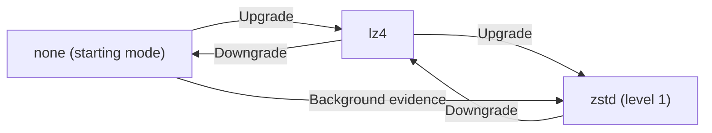

# Architecture

`tx` is designed to fully saturate modern cloud hardware - SSD, network, and CPU
- during file transfers. Four capabilities make this possible: adaptive
concurrency, adaptive compression, background durability, and lightweight
verification.

The architecture sits on top of the FTCP command protocol documented in
[docs/ftcp/OVERVIEW.md](../ftcp/OVERVIEW.md). Operator-facing command behavior
and flags live in [docs/pub/CLI.md](../pub/CLI.md).

Mode-specific transfer ordering and source-side load goals are described in
[TRANSFER.md](./TRANSFER.md), including the difference between `fast` and
`gentle` transfer/sync paths.

## Concurrency

A single TCP connection cannot fill a 25 Gbps NIC, and a single thread cannot
keep an NVMe SSD busy. `tx` solves both problems with a probe → plan → execute
pipeline that auto-tunes parallelism to match the hardware on both ends.

### Probe

Before any data moves, the client runs a two-phase `PROBE`:

1. **Discovery** — a 1-byte probe measures round-trip latency and retrieves
   server capabilities: CPU count, IO depth per CPU, socket buffer sizes, and
   the server's gentle-mode budgets.

2. **Throughput** — a configurable payload probe (default 1 MiB) measures
   actual link bandwidth. In fast mode the client fans out `server-cpu`
   parallel probe connections to measure aggregate throughput; in gentle mode
   it runs sequential samples.

From these measurements the client computes:

- **Link speed** (Mbps) — rounded to the nearest 100 Mbps.
- **Suggested concurrency** — `server_cpus × io_depth` in fast mode (default
  IO depth is 4), or a server-advertised percentage of CPUs in gentle mode.
  Clamped to `[2, 256]`.
- **Suggested cipher** — resolved from `AUTH key noise-v1` discovery if
  encryption is enabled: AES-GCM only when both the client accelerates it and
  the server recommends it, ChaCha20-Poly1305 otherwise.

### Connection pool

Once the probe completes, the client opens two independent connection pools:
one for large (potentially slow) data transfers, and one for quick commands.

| Pool    | Commands                         | Size                                  |
|---------|----------------------------------|---------------------------------------|
| data    | `SEND`, `CXSUM`                  | at most `concurrency`                 |
| control | `ACK`, `STATUS`, `TXFER`, `SYNC` | `concurrency`, grows during a burst   |

`concurrency` is the probe's suggestion, or `--concurrency` when set, clamped
to `[2, 256]`. Both pools work the same way and differ only in growth:

- **Warm.** With keep-alive, each pool opens `concurrency` connections up
  front, during the probe, so the first `SEND` and `ACK` requests find a
  connection ready. Without it, a connection serves one command and cannot
  be heartbeated, and the server closes one that sends nothing for its idle
  timeout, so the pools dial on demand instead.
- **Most recently used first.** Idle connections form a stack. A borrower
  always gets the most recently used one, so steady traffic reuses the same
  connections and the unused ones sink to the bottom.
- **Scale down.** When the server grants keep-alive, once per heartbeat
  interval (one quarter of the keep-alive window: 15s at the default 60s), a
  pool that has been used keeps the most connections it had in use at once
  during that interval, plus `.25x` buffer for bursts, and at least one. It closes
  the rest from the bottom of the stack. For example, 90 open connections with
  at most 40 in use shrink to 50. Because borrowers take from the top, this
  never closes a connection that steady traffic is about to reuse.
- **Grow.** A pool below its size dials on demand. The data pool never grows
  past `concurrency`: when every data connection is busy, a `SEND` waits for
  one to come back. A transfer is scheduled so that this does not happen; see
  [Parallel execution](#parallel-execution). The control pool dials past
  `concurrency` during a burst and keeps up to `concurrency` idle afterwards.

`tx recv copy` uses one client for all its phases (transfer, data, converge,
and verification), so the pools warm once.

Every pooled connection has already completed the Noise handshake and
`FINISH` when the client encrypts. When the
server grants keep-alive (negotiated on the discovery probe via
`keep-alive=auto` / `keep-alive-ms`), pooled connections are long-lived
sessions: each is upgraded with a zero-payload keep-alive PROBE when dialed, and
a connection whose response was cleanly consumed returns to its pool instead of
being closed. Reused connections skip the TCP and Noise handshakes, keep their
session keys, and keep their congestion window warm across batches. Two guardrails keep silently dead
connections out of the pools: once per quarter of the granted idle window, a
background loop heartbeats each pooled connection idle for that long with a
zero-payload PROBE round trip (a failed heartbeat closes the connection and
starts a replacement, and borrowers peek for a pending EOF before reuse), and
the server independently reaps connections that send nothing for the keep-alive
window (`--idle-timeout`, default 60s). Both ends set `TCP_USER_TIMEOUT` to
30s, so the kernel closes a connection whose sent data goes unacknowledged
that long, or whose peer stops reading that long, and the work on it fails
and is retried. `tx recv get` to stdout cannot resume, so a consumer that
pauses for 30s fails it.

Against servers without keep-alive, a connection is closed after one use and
the next request dials its own. When a kept-alive response is not read through
its terminal `OK` line (an `ERR`, a malformed or truncated stream, a cancelled
request, or a caller that stops early), the connection is closed and a
background goroutine opens and authenticates a replacement. Replacements
restore a pool only to the size it last scaled to, and fill a slot the
closed connection freed, so they never push a pool past its size or undo a
scale-down.

A `CXSUM` response is checked as it streams: frame trailers must match their
header's file ID, and lines are bounded like every other response. The
client's `ChecksumBatchOptions.HashTimeout` sets one read deadline for the
whole response: that long per started 4 MiB of hashing the request asks for
in total, set before the request is sent. There is no per-read re-arming:
the server buffers frames, 64 KiB at a time in plaintext and in whole records
on an authenticated connection, where it flushes finished checksums as a short
record at a frame boundary at most every 250 ms, so progress arrives steadily
rather than only when records fill. The wait for a pool connection does not
count against it. A timed-out
connection is closed, not pooled.

### Windowing and batching

The probe results feed a planning step that sizes the unit of work each TCP
connection handles. The goal is fixed-size batches: whether a batch contains
many small files or a single slice of a large file, each TCP connection does
roughly the same amount of work.

**Batch size.** The client computes a batch size from the probe:

```
perFileWorkers = suggestedConcurrency / windowConcurrency
batchMaxBytes  = windowBytes / perFileWorkers          (rounded up to power-of-2 MiB)
```

The default window is 512 MiB with a window concurrency of 4. On a 24-CPU server
in fast mode (IO depth 4), suggested concurrency is 96, giving
`perFileWorkers = 24` and a batch size of ~32 MiB. The result is capped at half a second of
per-connection link bandwidth, then clamped: the floor is the larger of the
server and client socket buffers (no point making a batch smaller than what the
OS has already allocated for the connection), and the ceiling is the window
size.

**Small files → packed batches.** The manifest is walked in order and files are
packed into batches until the next file would exceed `batchMaxBytes`. A batch
of 1000 tiny files and a batch containing one 32 MiB file are the same unit of
work. Each becomes one multi-file `SEND` request, or several in parallel when
SEND slots are free (see [Parallel execution](#parallel-execution));
metadata-heavy batches can require several requests on the same worker.
This avoids the per-connection overhead that makes small-file transfers slow in
tools that open one connection per file.

**Request memory.** PROBE separately advertises `target-request-bytes` (8 MiB)
and `max-request-bytes` (64 MiB). These count encoded metadata before
compression, including line terminators, rather than the file content scheduled
by a work batch. SEND groups, directory metadata, ACK lists, and CLI checksum
batches split at the target without exceeding the maximum. Work-size overrides
do not override these limits. Direct `GetChecksum` calls remain single requests.

The server verifies one bounded request body and parses its entries once into
compact ordered records. All entries are validated before processing, and the
decoded body is released before applying the records. Invalid or truncated ACK
requests apply no acknowledgments; earlier successful requests remain applied
when a later request fails. Records, frame buffers, and bounded decoder history
are additional memory, so the request limit is not a total heap limit. Many
short entries can require more record storage than their encoded payload.

Logical transport frames remain 4 MiB, independently of request and work sizes.
SYNC has its own `max-sync-request-bytes` advertisement (1 GiB by default) and
is checked before transmission, without splitting the manifest.

**Large files → split windows.** When a single file exceeds `batchMaxBytes`,
it is split into windows of that size. Each window is downloaded on its own TCP
connection, in parallel when SEND slots are free, with the number of
concurrent windows capped by `windowBytes / batchMaxBytes`. The pieces are written to the correct offsets in
the output file and acknowledged independently. This means a 1 GB file on a
fast link is not bottlenecked by a single TCP stream — it is sliced into
parallel chunks that saturate the NIC.

**Gentle mode scaling.** When concurrency is low (gentle mode defaults to 25%
of server CPUs), the planner detects that there are not enough slots for both
window concurrency and per-file parallelism. It reduces window concurrency to
match suggested concurrency, giving all slots to concurrent file downloads
rather than splitting individual files. This keeps the batch size large and
avoids fragmenting work on a resource-constrained server.

### Parallel execution

With batches planned and the pools warm, `concurrency` workers each take a
batch and issue `SEND` requests. A transfer holds at most one SEND slot per
data connection, so it never issues a `SEND` that would wait for a connection.
Each worker:

1. Waits for one SEND slot, then takes any other slots free at that moment
   to split the batch into parallel `SEND` requests, or the large file into
   parallel windows. A batch never waits for extra slots, so splits use only
   idle capacity, such as when other workers are acknowledging or the
   transfer is near its end.
2. Borrows a pre-authenticated connection from the data pool for each slot.
3. Sends a `SEND` command requesting one or more file windows, reads the
   `FX/1` frame stream, and writes frames to disk.
4. Returns each connection to the data pool and frees its slot.
5. Sends a batched `ACK` confirming received windows on a control
   connection.

Because every worker has its own TCP connection, there is no head-of-line
blocking: a slow file on one connection does not stall transfers on the others.
On the server side, each fast-mode `SEND` handler uses `fadvise(SEQUENTIAL)`
for windows of 128 KiB or more (smaller ones fit the kernel's default
readahead) and background `readahead(2)` to prefetch the next frame into the
page cache while the current frame is being written to the socket. When
encryption and compression are off, the output is a raw TCP socket, and the
frame is at least 1 MiB, the server uses a zero-copy `splice`/`tee` path that
moves file data from the page cache to the NIC without copying through
userspace. Smaller frames go through a 64 KiB buffer per response, so many
small files share one write syscall.

The net effect is that disk reads, compression, network writes, and disk writes
on the receiver all overlap — keeping SSD, CPU, and NIC busy simultaneously.

## Adaptive Compression

Compression helps when data compresses well and the link, not the CPU, limits
the stream; otherwise its CPU time is overhead. With `--compress adapt`, the
server picks each frame's codec to maximize the stream's logical throughput.

### Frame-level adaptation

Files are streamed as 4 MiB frames. After each frame the policy takes its
logical throughput: logical bytes / (prepare + write time), where prepare
covers the disk read and compression and write covers handing the frame to the
connection. The policy compares throughput, not the latency ratio, because
when the receiver's disk is the bottleneck its backpressure makes the sender
look network-bound, yet compression cannot raise throughput.

Prepare time covers all of a frame's read and compression work, including the
codec's flush on close: fast-mode lz4 compresses its blocks on other
goroutines while it closes, so closing is where most of its time goes. It also
covers hashing the frame on every path; a zero-copy frame hashes the copy it
reads from its hash pipe. Write time covers the header, payload, and trailer
writes, and the flush of earlier buffered frames that a zero-copy frame forces.

A write returns once its bytes are in the 64 KiB response buffer or the
socket's send buffer, before they reach the receiver, so the first frames of a
SEND write at memory speed. An adaptive SEND therefore reads the connection's
TCP delivery rate (`tcpi_delivery_rate` from `TCP_INFO`), and the policy sees
each frame's write time as the larger of the measured write and the frame's
wire bytes over that rate. The SEND reads after its first adaptive frame and
again as it writes, after 4 MiB of wire bytes and then after twice as many
each time, up to 32 MiB. It keeps the highest rate it has read, as BBR
estimates bandwidth: a fresh or idle connection in slow start, or before its
first ACK, reports a rate far below its path. A rate that is too high costs
nothing, since a frame that waits on the path measures that wait. The
maximum covers one SEND, so a later SEND sees a path that slowed. A rate from an
application-limited sample is not used: it measures how fast the sender
produced bytes, not how fast the path takes them, so it would charge a slow
compressor's frames for its own slowness. The read reaches the socket under an
authenticated session or a fault wrapper. A SEND with no adaptive item reads
nothing.

Without a kernel rate (a connection that is not a TCP socket, a kernel before
4.9, or a failed read), the SEND uses the rate the connection's own writes
showed: adaptive frames' wire bytes over their measured write time, each sum
decayed by 7/8 per frame, kept across the connection's SENDs. Writes that
land in buffers make it high, which only leaves the measured write in force;
writes that wait on the path make it the path's rate. The rate is tracked
even when the kernel's is used. When a transfer completes, the server logs a
`txfer-rate` line after `txfer-complete`: how many files and windows reached
the policy, how many used a background sample, and the range and mean of
what the kernel and the server's writes said the rate was, which `--stats`
also records.
A read costs one `getsockopt` (about 0.4 µs) and allocates nothing after the
connection's first.

Every adaptive frame is a sample except a window's last frame when no window
of the file follows. When one follows, the last frame is a sample too, and its
decision picks the next window's first codec.

Codec exploration runs in the background. A sampled frame copies up to
256 KiB from bytes already read for sending or hashing. A worker compresses
that owned copy with **both lz4 and zstd level 1**, measuring their sizes and
encode times. The larger sample can include repetition beyond lz4's 64 KiB
match distance. Zstd is measured even when lz4 gains nothing.

At most one job per four CPUs, and at least two, runs across the process.
Admission, result checks, and cleanup never wait for a worker; busy workers
skip new requests. A canceled or finished SEND leaves an active worker owning
its buffers until it exits. Workers retain no file descriptor and do no
additional file or socket I/O. Only the small sample copy counts toward a
sending frame's prepare time.

A file normally samples every eighth frame, by its index in the file, and
requests each frame while a comparison needs evidence. A sample is requested
only while the file has the frames a switch needs, through one sent in the new
codec. During a comparison, that is the rest of the baseline (a fresh file
only) and of **four independent winning samples**, plus that frame: nine
frames for a fresh file. Outside a comparison, a sample can only detect
changed data, which takes three moved samples eight frames apart before a
comparison starts: 22 frames, or 30 before the file has a reference sample.
Frames are counted, not bytes, since a window's last frame can be short. The
count is an estimate: windows that are not multiples of 4 MiB cut more frames
than it counts, and concurrent windows of one file do not see each other's
evidence. The estimated remaining transfer time must also exceed the sampling
budget, based on the observed send rate and the last job's wall time. A
completed result is always used, since its cost is already spent.

The stream keeps sending in its learned *home* codec while a comparison runs.
The candidate's estimated frame cost retains measured read/hash work, replaces
the codec CPU cost with its sampled cost, and scales transport time by its
sampled ratio. The sequential test compares these estimates with observed home
costs, including noise in both. Upgrades need a 3% gain with 2.5 standard errors
to spare; downgrades allow a 3% throughput loss for the cheaper codec. At the
16-sample cap the means decide with 6% margins. Zstd can be selected directly
from none after independent evidence; lz4 does not have to win first.

The policy validates a switch against eight normally sent frames. If their
smoothed cost is over 10% worse than the previous mode, it restores that mode
and backs off. When compression did not reduce write time per logical byte,
it learns a receiver-disk floor that future estimates cannot compress away.
A changed path gets a prompt retry rather than a long penalty based on the old
baseline. Three actual compressed frames gaining less than 1.08:1 drop straight
to none. Background estimates cannot measure receiver decoding directly, so
validation remains necessary.

Lost comparisons back off geometrically from 24 to 256 frames, or up to 4,096
when their estimated cost is high. Sustained changes in home cost, its read or
write component, or sampled compressibility reset exploration. Independent
zstd ratios also detect data that starts compressing with zstd while lz4's
ratio stays flat. A stalled frame is clipped so it cannot decide a comparison
or reset the schedule alone.

The policy state belongs to the file, not the window. A large file is sent as
many windows, so a learned mode and the policy's learned state carry on from
one to the next. The server keeps the state in the transfer, only for adaptive
files that span more than one window:

- A window loads the state only when an earlier window preceded it (its offset
  is above zero). A resumed tail window loads, and finds nothing if the server
  restarted.
- A window saves its state only when another window follows, within the smaller
  of the manifest size and the file's size on disk. A single-window file, the
  last window of a file, a resumed tail window, and a window of a file that
  already shrank save nothing, because no later ACK would free the entry. A
  window saved before its file shrank stays until the transfer is reaped, one
  entry per file. A window saves only if it changed the state it loaded, so one
  that learned nothing (a single frame) creates or refreshes no entry. A window
  that ends in an error after at least one frame still saves.
- A SEND collects its items' states and applies them with its window hashes in
  one call, under one acquisition of the transfer lock per request. Loads take
  only the state's own mutex.
- Each window works on its own copy, so concurrent windows of one file on
  different connections do not lock per frame, and the last save wins.
- An entry is freed when its file is Done or Missing (a save for such a file is
  skipped, and a revived file starts fresh) and when the transfer is deleted or
  reaped.

A zero state is a fresh policy at `none`. The stored state remains below
128 bytes, so map values do not require a separate allocation.

The link is shared; the data is not. What a byte costs to read and send
uncompressed, and any receiver-disk floor, is the same for every file on a
connection, while a file's ratio and codec costs depend on its data. So each
connection keeps the uncompressed baseline its latest file measured (home's
cost, write time, and their spread), and a window that starts a file with no
state of its own begins from it: its baseline counts as seeded, and its first
comparison starts on its first frame with its own samples. A seeded file can
switch by its fifth frame instead of its ninth, which matters when a file's
windows run in parallel and each chain of state sees only a few frames. A
stale baseline costs at most a switch that validation on the file's own
frames undoes.

### Compression ladder

The background comparison engine explores three codecs:



The default starting point is `none`. On slow links with compressible data, the
server upgrades toward `zstd` and can effectively exceed line rate because
compressed frames are smaller than the raw data. On fast networks with
incompressible data (e.g. already-compressed media), the server stays at `none`
or downgrades back. Occasional background samples still use bounded CPU.
Mixed datasets (e.g. a directory with both text logs and JPEG images) see
the server adapt frame-by-frame as data characteristics change.

The client can also force a specific compression mode (`--compress none|lz4|zstd`)
to skip adaptation.

## Verification

`tx` verifies integrity in two layers:

- **Post-copy metadata verification** checks size, mtime, mode, and link
  targets after every copy by default.
- **Optional sampled data verification** extends that with checksum comparison
  of selected byte ranges using `CXSUM`.

For operators, the main CLI modes are:

- `--verify meta`
- `--verify N%data`
- `--verify full`
- `--verify <duration>`

The detailed design and current implementation live in
[VERIFICATION.md](./VERIFICATION.md), including the deterministic sampling
algorithm, partial-success behavior (`[partial-ok]`), and the relationship
between `SEND`, `ACK`, and `CXSUM`.

## Durability

Naive transfer tools call `fdatasync` inline after every file write, which
serializes disk flushes and stalls the download pipeline. On cloud NVMe,
inline fdatasync per file costs 1–5 ms; for a million small files that adds
15–80 minutes of pure sync overhead. Skipping fsync entirely risks data loss
on crash. `tx` solves this with a three-layer durability strategy controlled
by `--fsync-interval` (default 512 MiB).

### Background batch fdatasync (default)

After each file's writes complete, the file descriptor is `dup()`'d and enqueued
to a background channel along with its written byte count. A reader goroutine
accumulates requests; when the accumulated bytes reach the threshold (512 MiB by
default, raised under backlog) or 4096 files, it spawns a worker goroutine that:

1. Groups requests by `(dev, ino)` via `fstat` — hardlinked files are synced
   once. A descriptor whose `fstat` fails is synced on its own.
2. Calls `fdatasync` on each unique inode.
3. Closes the dup'd file descriptors.

Because the sync callback returns immediately after enqueue, the download and
ACK path is never blocked by disk flushes. The cost is that a file's ACK
precedes its sync. A failed `fdatasync` is not retried, since after an `EIO`
the kernel may have dropped the dirty pages and a second call can succeed
without the data. Instead, `tx recv copy` and `tx recv get` finish the
transfer, then exit 1 and name the files that failed to sync.

### Inline fdatasync

`--fsync-interval 0` switches to inline mode: each file blocks on `fdatasync`
immediately after its writes complete. This gives per-file durability
guarantees at the cost of throughput.

### Syncfs-only

`--fsync-interval -1` skips per-file fdatasync entirely and relies on the
final filesystem sync.

### Final syncfs

After all downloads complete and the background batcher drains, `tx` calls
`syncfs` on the target filesystem with a 10-second timeout. This catches any
writes the OS hasn't flushed yet. A failed or timed-out `syncfs`, like a
background drain that its timeout cuts short, leaves durability unconfirmed:
it prints a warning and adds it to `--stats` `warnings`, but does not change
the exit code. `--skip-fsync` disables both per-file and final syncing.
