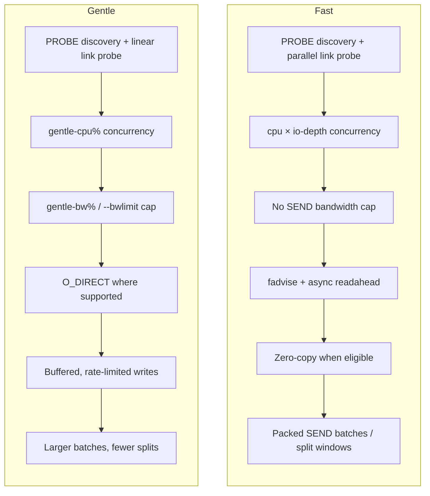
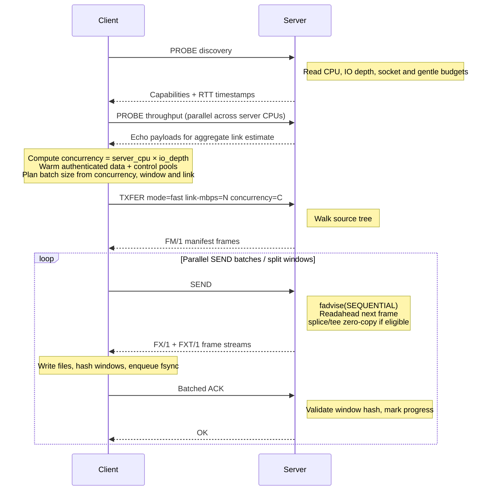
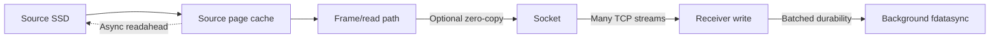
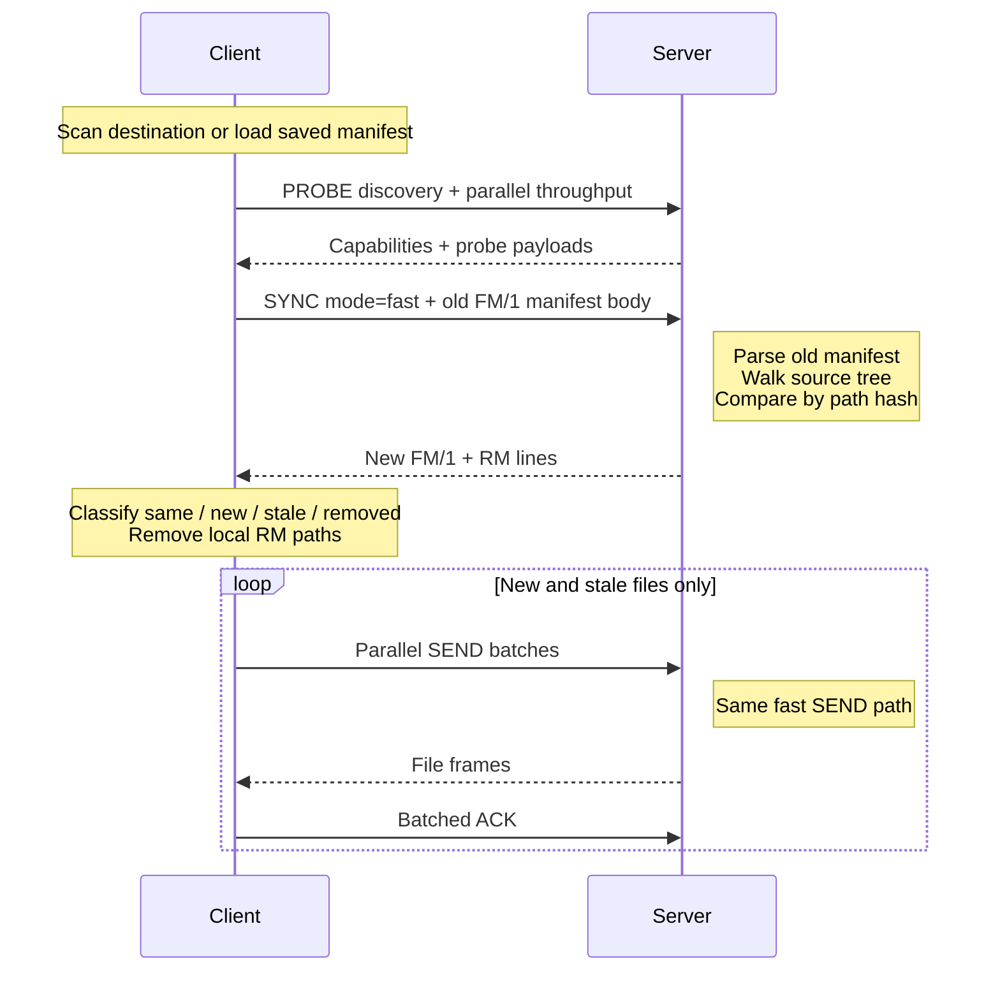
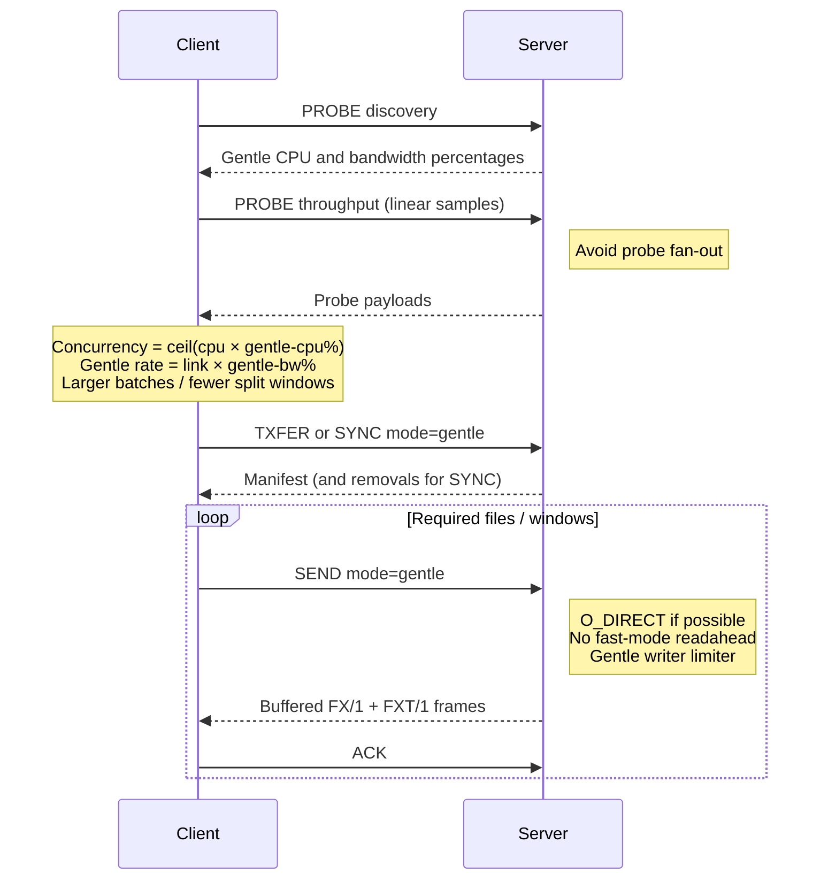
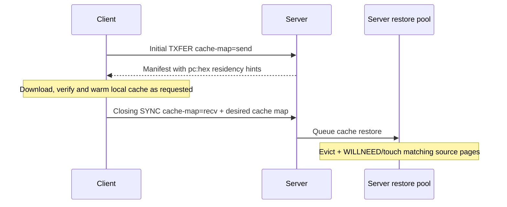

# Transfer Modes

`tx` has two source-side load strategies: `fast` and `gentle`. They use the
same FTCP verbs and frame format, but they make different choices about
concurrency, read path, bandwidth, and page-cache behavior.

## Goals

| Mode | Goal | Source-side behavior |
|------|------|----------------------|
| `fast` | Move data as quickly as the source, receiver, and network can sustain. | Use high probe-derived concurrency, keep TCP streams busy, allow the source page cache to help, prefetch the next frame, and use zero-copy when possible. |
| `gentle` | Move data while minimizing interference with other work on the source. | Use a smaller CPU budget, apply gentle bandwidth limits, prefer direct I/O to avoid displacing the source page cache, and avoid extra read-ahead pressure. |

Fast mode assumes the transfer is allowed to be the main workload. It is
designed to keep the pipeline full: disk reads, optional compression, socket
writes, receiver writes, and background durability overlap so no single stage
idles the rest of the system.

Gentle mode assumes the source host is shared. It still transfers correctly and
concurrently, but it treats source CPU, source network, and source page cache as
budgets to preserve. The implementation cannot make a transfer free, but the
intent is that source-side impact is bounded and explicit.

## High-level Shape

Both modes use the same client-side planner:

- small files are packed into multi-file `SEND` batches
- large files are split into windows when that helps fill the connection pool
- each completed file/window is acknowledged with `ACK`
- receiver fsync is batched in the background by default

The difference is how aggressively the planner is allowed to fill the source.

## Fast Transfer

A fast transfer is the clean-start path: the client has no usable local
manifest or destination state, so it asks the server for a full manifest and
then downloads every required entry.

Fast mode's core choices:

- **Concurrency:** `server_cpu * io_depth`, clamped by the client. The default
  server IO depth is currently 4.
- **Probe:** throughput probing fans out across server CPUs so the client sees
  aggregate capacity rather than a single stream.
- **Batching:** the client chooses a batch/window size small enough to create
  enough parallel work to saturate the link.
- **Server reads:** `posix_fadvise(SEQUENTIAL)` plus asynchronous
  `readahead(2)` for the next frame when the window is large enough.
- **Zero-copy:** when the frame is uncompressed, the connection is a raw TCP
  socket, and the read is not direct I/O, Linux can use `splice`/`tee` to move
  bytes from the page cache to the socket without copying file payloads through
  userspace.
- **Compression:** adaptive compression can upgrade when the network is the
  bottleneck and downgrade when CPU or poor ratio makes compression expensive.

The expected result is a full pipeline:

The tradeoff is that fast mode may intentionally consume source CPU, NIC,
storage bandwidth, and page cache because those resources are what let the copy
finish sooner.

## Fast Sync

A fast sync is the convergence path when the destination already has state. The
client sends what it believes about the old tree; the server streams a fresh
manifest plus removals; the client downloads only the delta.

Unchanged files are not re-read from the source. On the server, matching regular
files are auto-acked after the `SYNC` walk so transfer progress represents the
delta that remains. Changed or new files then use the same fast `SEND` behavior
as a full transfer.

Fast sync is the common "finish the copy now" mode after an initial pass: it
spends source resources only on the current delta, but it spends them
aggressively.

## Gentle Transfer and Sync

Gentle mode keeps the same logical ordering as fast mode: probe, manifest,
plan, `SEND`, `ACK`. The changed pieces are the resource budgets and the
server-side read/write path.

Gentle mode's core choices:

- **Concurrency:** a server-advertised percentage of CPUs, defaulting to 25%.
  IO depth is ignored for the gentle concurrency calculation.
- **Probe:** throughput probing uses linear samples by default instead of
  fanning out across all server CPUs.
- **Bandwidth:** each gentle `SEND` is wrapped in the per-transfer gentle
  limiter derived from observed link bandwidth and `gentle-bw%`. If the server
  has `--bwlimit`, that limiter also applies to gentle transfers. Fast
  transfers do not respect the gentle bandwidth limiter.
- **Batching:** when the suggested concurrency is low, the planner reduces
  window concurrency and gives slots to whole-file downloads instead of
  fragmenting individual files. This avoids creating lots of tiny source reads.
- **Server reads:** the server tries to open files with `O_DIRECT`, bypassing
  normal page-cache fill and reducing eviction of the source workload's hot
  pages. If direct I/O is not supported for a file or filesystem, it falls back
  to the normal buffered open.
- **Zero-copy:** direct I/O is not compatible with the pipe-based zero-copy path,
  so gentle mode normally uses buffered frame streaming.
- **Deadline checks:** when a deadline is configured, gentle `SEND` checks pace
  and can fail early if the measured rate cannot finish in time.

For sync, the manifest comparison is identical to fast sync: unchanged files are
skipped, removed paths are returned as `RM`, and only new/stale files are
downloaded. The delta download uses `SEND mode=gentle`, so the source-side read
and network behavior remains bounded.

When `copy --cache-load` is enabled, sync also participates in page-cache
convergence:

That cache-restore work is asynchronous and advisory, and fast mode only: the
server rejects `cache-map` with gentle mode, and the CLI rejects `--cache-load`
with `--mode gentle`.

## Choosing a Mode

Use `fast` when the shortest wall-clock time matters more than temporary source
load: dedicated transfer hosts, maintenance windows, empty receivers, or final
delta convergence.

Use `gentle` when the source is serving production traffic or another workload:
first-pass migration, repeated convergence loops, or any case where source CPU,
network share, and page-cache residency are more important than peak throughput.

It is normal to combine them:

1. Run an initial copy in gentle mode to avoid disrupting the source.
2. Rerun syncs in gentle mode until the delta is small.
3. Use fast mode for the final convergence window if the source can tolerate it.
