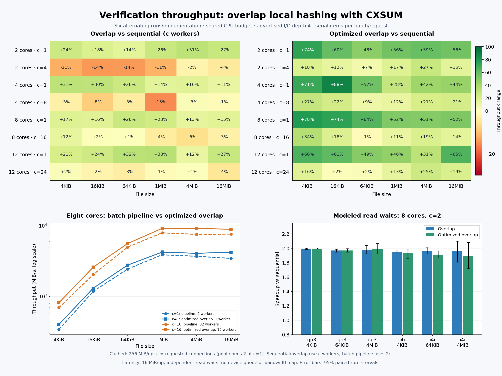

# Verification throughput

## Proposal

Run each batch’s local hashing and server CXSUM request concurrently. Use one
verification worker per requested data connection, capped by the negotiated pool
size. Each side hashes its items sequentially within a batch or request.

Reduce the serial work as well: compute only requested hash algorithms, reuse
server hashers within each request, size reusable read buffers to the requested
ranges, and format zero-payload checksum frames into a pooled buffer. Preserve
client file grouping, request-order frames, error ordering, and exact encoding.
The first failure cancels the peer operation; the worker joins both operations
before returning and compares hashes after successful response validation.

The hypothesis is that overlapping the two read streams hides their combined
latency, while reducing per-file CPU and allocation costs helps cached workloads.
These experiments test that hypothesis without adding hashing workers inside a
batch or request.

## Experiment

`BenchmarkVerifyInMemory` runs the real verifier against a loopback FTCP server.
Client and server share one process on an AMD Ryzen AI 9 HX 370. Both GOMAXPROCS
and OS affinity are pinned to 2, 4, 8, or 12 distinct physical cores, without SMT
siblings. Sets above four include lower-clock cores. The connection plan uses
`cpus/2` as a nominal server CPU count; it does not divide the CPU capacity
between the two sides.

Each cached operation verifies a 256 MiB logical tree backed by at most 64 MiB of
memfds. Both sides read the same memfd pool: the server duplicates a descriptor
after store lookup; the receiver opens `/proc/self/fd/N`. This excludes on-disk directory traversal. Files are 4 KiB,
16 KiB, 64 KiB, 1 MiB, 4 MiB, or 16 MiB. Requested concurrency **c** is one or
planned: 4/8/16/24 for 2/4/8/12 CPUs. Advertised I/O depth remains four. The client
opens two pooled connections at c=1, but the proposed verifier uses one worker.
Connections are probed and warmed before measurement.

Four implementations distinguish the effects:

| Implementation | Verification workers | Work within one batch | Checksum computation and frames | CSV build |
|---|---:|---|---|---|
| Sequential | c | Local hashing, then CXSUM | Both hash algorithms; per-item hashers and frame formatting | `sequential` |
| Overlap | c | Local hashing alongside CXSUM | Same as sequential | `overlap` |
| Optimized overlap | c | Local hashing alongside CXSUM | Requested algorithms, reused hashers/buffers, pooled frame formatting | `optimized` |
| Batch pipeline | 2c | Local hashing, then CXSUM; other batches can overlap | Same as sequential | `pipeline` |

The 48-case cached matrix compares sequential, overlap, and optimized overlap
across all sizes, CPU budgets, and connection counts. There are six alternating
runs per implementation, using 200 ms minimum subbenchmarks, in sequential /
overlap / optimized order and its reverse. An operation can exceed 200 ms.

A separate eight-core comparison alternates the batch pipeline and optimized
overlap six times, covering all six sizes at c=1/16. It tests the combined
proposal against the existing 2c-worker pipeline. These measurements are
independent of the 48-case matrix, whose sequential control isolates overlap
under the same worker cap.

Aggregate changes are equal-weight geometric means of paired case ratios.
The 95% intervals resample six whole paired runs, 10,000 times. Graph cells and
table rates use medians of six runs; their ratios can differ from the paired
aggregate. Local-only controls remain available in the benchmark but are
excluded from these comparisons.

## Results

Optimized overlap improves cached throughput **15.8%** against the batch pipeline
at eight cores (95% interval **10.2% to 22.4%**), while using c workers instead of
2c. All 12 case medians improve. CPU per GiB falls 17.3%, allocation count falls
43.8%, and allocated bytes fall 21.0% in that comparison.

With the same worker cap in both implementations, overlap alone improves the
cached matrix **7.1%** overall. It helps at one connection (**19.8%**) but regresses
at planned concurrency (**−4.3%**). Adding the serial checksum optimizations
raises the 48-case improvement to **32.7%**. The two comparisons use different
controls; the combined gain cannot be attributed to overlap alone.



| Comparison | Scope | Throughput change, 95% interval | CPU per GiB change |
|---|---|---:|---:|
| Overlap / sequential | All 48 cases | +7.1% (+4.3% to +10.6%) | +17.9% |
| Overlap / sequential | c=1 | +19.8% (+15.3% to +24.0%) | +32.7% |
| Overlap / sequential | Planned c | −4.3% (−7.2% to −0.9%) | +4.9% |
| Optimized overlap / sequential | All 48 cases | +32.7% (+25.4% to +41.1%) | −1.0% |
| Optimized overlap / sequential | c=1 | +53.0% (+44.1% to +64.5%) | +13.9% |
| Optimized overlap / sequential | Planned c | +15.1% (+9.2% to +21.4%) | −14.0% |
| Optimized overlap / batch pipeline | Eight cores, 12 cases | +15.8% (+10.2% to +22.4%) | −17.3% |

Against the sequential control, optimized overlap reduces allocation count by
40.7% and allocated bytes by 23.9%. Its overall CPU per GiB change is within
noise: −1.0%, with an interval of −6.1% to +3.7%. Overlap alone raises CPU per GiB
17.9%; more concurrent execution does not guarantee better cached throughput.

The weakest optimized-overlap median against the sequential control is
64 KiB / 8 cores / c=16: 4,900 → 4,855 MiB/s (−0.9%). The next weakest gains are
+1.9% and +2.4% at 12 cores / c=24 for 16/64 KiB. Overlap alone has larger
regressions: −15.2% for 1 MiB / 4 cores / c=8, −13.9% for 16 KiB / 2 cores / c=4,
and −13.6% for 64 KiB / 2 cores / c=4. The serial optimizations offset these in
the combined proposal.

Eight-core throughput against the batch pipeline, in MiB/s:

| File size | c=1 pipeline (2 workers) | c=1 optimized overlap (1 worker) | c=16 pipeline (32 workers) | c=16 optimized overlap (16 workers) |
|---|---:|---:|---:|---:|
| 4 KiB | 340 | 400 | 693 | 812 |
| 16 KiB | 1,180 | 1,309 | 2,041 | 2,595 |
| 64 KiB | 2,446 | 2,778 | 4,995 | 5,606 |
| 1 MiB | 3,884 | 4,242 | 7,942 | 9,180 |
| 4 MiB | 3,704 | 4,075 | 7,553 | 9,207 |
| 16 MiB | 3,456 | 4,233 | 7,634 | 8,906 |

## Read-latency sensitivity

The benchmark also injects independent waits before content reads, using the
Netflix gp3 and i4i beta fits at service-capacity-modeling revision
`c56c0dd7861a`. Larger reads include an assumed size term; open/stat work is real
and undelayed. The models have no shared device queue, aggregate bandwidth or
IOPS limit, cache model, or correlated stalls. They test service latency rather
than predict cloud-volume throughput.

Both sides share eight pinned cores, c=2, and advertised I/O depth four. Each
operation verifies 16 MiB to keep slow 4 KiB cases practical. Each implementation
has six alternating one-operation measurements per case, after pool warmup.
This smaller dataset is analyzed separately from the cached matrix.

Across three sizes per model, overlap alone improves throughput **98.1%** for
gp3 (interval 96.2% to 100.4%) and **96.0%** for i4i (89.2% to 102.1%). These gains
come from overlapping the two serial read streams.

| Model | File size | Sequential MiB/s | Overlap MiB/s | Optimized overlap MiB/s |
|---|---|---:|---:|---:|
| gp3 | 4 KiB | 3.50 | 6.97 | 6.98 |
| gp3 | 64 KiB | 52.74 | 104.13 | 104.05 |
| gp3 | 4 MiB | 420.60 | 821.70 | 836.10 |
| i4i | 4 KiB | 21.09 | 41.16 | 41.62 |
| i4i | 64 KiB | 295.60 | 575.55 | 564.41 |
| i4i | 4 MiB | 1,621.03 | 3,249.11 | 3,108.47 |

## Evidence and limits

The [measurements CSV](data/verify-simple.csv) preserves all 1,116 per-run results:
throughput in MiB/s, CPU in core-s/GiB, CPU capacity used, allocation count/bytes,
hash/server busy, pool size, and requested/delivered read waits. The `cached`
series identifies the 48-case matrix; `pipeline` identifies the independent
2c-worker comparison. Both CPU and allocation metrics include client and server.
Busy metrics include waits, descheduling, parsing, and output; they do not
measure CPU utilization or storage queue depth.

The [analysis script](verify_results.py) recomputes aggregate changes and the
graph from the CSV. Run it from any directory; plotting requires matplotlib:

```sh
python docs/bench/verify_results.py
python docs/bench/verify_results.py --plot
```

The [benchmark guide](OVERVIEW.md#verification-microbenchmark) lists workload
controls and an invocation. Preserved binaries, hashing sources, raw benchmark
output, and validation logs are under `/tmp/tx-checksum-simple`.

Formatting, full vet/tests, and affected race tests pass. Integration tests
cover overlap, cancellation and errors in either direction, worker caps,
budget behavior, split requests, range validation, ordered error prefixes, and
descriptor cleanup. The frame encoder fuzz target checks byte-identical encoding
against `encoding.WriteFrame` and is registered in `fuzz-long` after its coverage
continued growing beyond ten seconds.

These measurements support overlapping verification and reducing serial checksum
costs. They do not establish physical-storage throughput, full CPU saturation,
or the best storage concurrency.

## Checksum parsing and batched lookups

This section measures two per-file cuts: the verifier parses checksum frames
without temporary field collections, and CXSUM resolves file references once
per request. [Verification](../arch/VERIFICATION.md) describes the behavior.

### Experiment and results

The baseline is `5b34346`, with the previous response parsers and per-item
`GetFile`. Both builds use 256 MiB logical trees backed by memfds, without
injected latency. The 54-case matrix covers all six file sizes, 2/4/8 pinned
physical cores, and 2/4/8 requested connections. Advertised I/O depth is four.
Each build runs six alternating times per case with a 200 ms minimum. Odd runs
reverse the CPU/connection and build orders. Both sides share the CPU budget.

Changes are equal-weight geometric means of paired case ratios. The 95%
intervals resample six whole paired runs 10,000 times, keeping cases together.

Together, the changes improve throughput **2.8% overall** (95% interval
**1.7% to 4.0%**) and **6.1% for 4 KiB files** (**2.9% to 9.1%**). Small-file
allocations fall about 25%, from roughly 40 to 30 per file. Across all sizes,
CPU/GiB falls 2.6%, allocation count falls 20.0%, and allocated bytes fall 3.8%.

| File size | Throughput change, 95% interval | CPU/GiB change | Allocation count change |
|---|---:|---:|---:|
| 4 KiB | +6.1% (+2.9% to +9.1%) | −6.1% | −25.0% |
| 16 KiB | +3.9% (+0.8% to +6.3%) | −4.6% | −24.9% |
| 64 KiB | +5.2% (+3.1% to +7.4%) | −4.4% | −24.6% |
| 1 MiB | +1.5% (−0.5% to +3.3%) | −1.1% | −19.9% |
| 4 MiB | +0.5% (−3.9% to +4.8%) | +0.5% | −11.7% |
| 16 MiB | −0.1% (−3.5% to +3.2%) | +0.2% | −12.4% |

At eight cores and eight connections, median 4 KiB throughput is
798 → 853 MiB/s. Large-file throughput as a group is +0.6% (−1.9% to +3.2%),
which these runs cannot distinguish from no change.

Separate 4 KiB comparisons run the baseline, parser-only, lookup-only, and
combined builds six times at four cores/two connections and eight cores/eight
connections, rotating and reversing build order. The parser alone reduces
allocations from 40 to 33 per file, and batched lookups alone reduce them to 37.
Neither isolated throughput change has an interval excluding zero in these
runs; the full matrix supports the combined small-file gain.

The short matrix's worst cell is 4 MiB / two cores / eight connections, down
10.0%. A separate one-second follow-up repeats all 1/4/16 MiB cases at two cores
and four/eight connections, six alternating times per build. That cell becomes
+8.0% (−3.7% to +23.3%), so the 10% regression does not repeat reliably. The
16 MiB / two cores / four connections case remains uncertain at −5.2%
(−11.4% to +1.1%). These results support the small-file gain, with less certainty
about individual larger-file cells. They do not establish physical-storage
throughput or independent client/server saturation.

### Profiling findings

Six-second CPU/allocation captures and two-operation Go traces identify
per-file overhead in the baseline. For 4 KiB files at eight cores/eight
connections, xxh3 accounts for only 2.6% of sampled process CPU, while CLI
response parsers account for 7.9% and server file lookups for 3.7%. Trailer
parsing accounts for about 22% of allocated objects.

Combined-build captures at four cores/two connections and eight cores/eight
connections put CLI response parsing at 3.9–4.2% of sampled CPU and trailer
parsing at 3.5–3.8% of allocated objects. These profiles confirm the changed cost
distribution; the paired benchmarks measure the throughput effect. Profiles
include setup and warmup, while `verify-measured` trace regions delimit timed
operations. Traced timing is excluded from throughput comparisons.

The traces also record four `fcntl` calls per local file from Go's failed
regular-file poller setup. A Linux file-open helper remains deferred in
[Ideas](../IDEAS.md#performance), along with size-based hashing workers.

### Reproduce the comparison

Run on Linux with Go 1.26 and `taskset`, from the repository root. Choose
physical cores without SMT siblings; this machine uses cores 0–7. Adjust the
affinity sets for other hardware. Keep generated binaries, logs, traces, and
profiles outside the repository. The following Bash commands build the baseline
in an isolated worktree and the proposed code from the working tree:

```bash
set -e
verify_out=$(mktemp -d /tmp/tx-verify.XXXXXX)
git worktree add --detach "$verify_out/baseline" 5b34346
(
  cd "$verify_out/baseline"
  go test -c -o "$verify_out/baseline.test" ./internal/cmd/filexfercli
)
go test -c -o "$verify_out/current.test" ./internal/cmd/filexfercli
unset TX_VERIFY_IO_LATENCY TX_VERIFY_BYTES

for run in 0 1 2 3 4 5; do
  cpu_budgets=(2 4 8)
  connections=(2 4 8)
  builds=(baseline current)
  if (( run % 2 )); then
    cpu_budgets=(8 4 2)
    connections=(8 4 2)
    builds=(current baseline)
  fi
  for cpus in "${cpu_budgets[@]}"; do
    for conc in "${connections[@]}"; do
      for build in "${builds[@]}"; do
        TX_VERIFY_IO_DEPTH=4 TX_VERIFY_CONCURRENCY="$conc" \
          taskset -c "0-$((cpus-1))" "$verify_out/$build.test" \
          -test.run='^$' \
          -test.bench="^BenchmarkVerifyInMemory$/^(4KiB|16KiB|64KiB|1MiB|4MiB|16MiB)$/^cpus=${cpus}$/^c=${conc}$" \
          -test.benchtime=200ms \
          > "$verify_out/run${run}-p${cpus}-c${conc}-${build}.txt"
      done
    done
  done
done
```

Compare matching case/run pairs. Convert Go's decimal `MB/s` to MiB/s by dividing
by 1.048576. Report `core-s/GiB`, `allocs/op`, `B/op`, `hash-busy`, and
`server-busy` alongside throughput. Busy metrics count batches/requests in
progress, including waits; they do not measure CPU use or hashing workers.
Compute geometric means from log ratios. For confidence intervals, resample
whole paired runs rather than individual cases.

For the longer follow-up, restrict the filter to `1MiB|4MiB|16MiB`, two cores,
and four/eight connections, and use `-test.benchtime=1s`. Analyze it separately
from the main matrix. To isolate the two changes, build parser-only and
lookup-only variants and repeat just the 4 KiB cases at four cores/two
connections and eight cores/eight connections.

### Reproduce profiles and traces

Use separate runs for throughput, CPU/allocation profiles, and tracing. For
example, after building the current binary above:

```bash
verify_filter='^BenchmarkVerifyInMemory$/^4KiB$/^cpus=8$/^c=8$'
TX_VERIFY_IO_DEPTH=4 TX_VERIFY_CONCURRENCY=8 \
  taskset -c 0-7 "$verify_out/current.test" -test.run='^$' \
  -test.bench="$verify_filter" -test.benchtime=6s \
  -test.cpuprofile="$verify_out/verify.cpu" \
  -test.memprofile="$verify_out/verify.allocs"

go tool pprof -http=localhost:8080 \
  "$verify_out/current.test" "$verify_out/verify.cpu"
go tool pprof -sample_index=alloc_objects -top \
  "$verify_out/current.test" "$verify_out/verify.allocs"

TX_VERIFY_IO_DEPTH=4 TX_VERIFY_CONCURRENCY=8 \
  taskset -c 0-7 "$verify_out/current.test" -test.run='^$' \
  -test.bench="$verify_filter" -test.benchtime=2x \
  -test.trace="$verify_out/verify.trace"
go tool trace "$verify_out/verify.trace"
```

The pprof web interface includes flamegraphs. In Go trace, inspect the
`verify-measured` regions to exclude setup and warmup. Whole-trace `sched`,
`syscall`, `sync`, and `net` profiles include background goroutines and summed
goroutine wait time; do not interpret their totals as wall time or CPU use.
